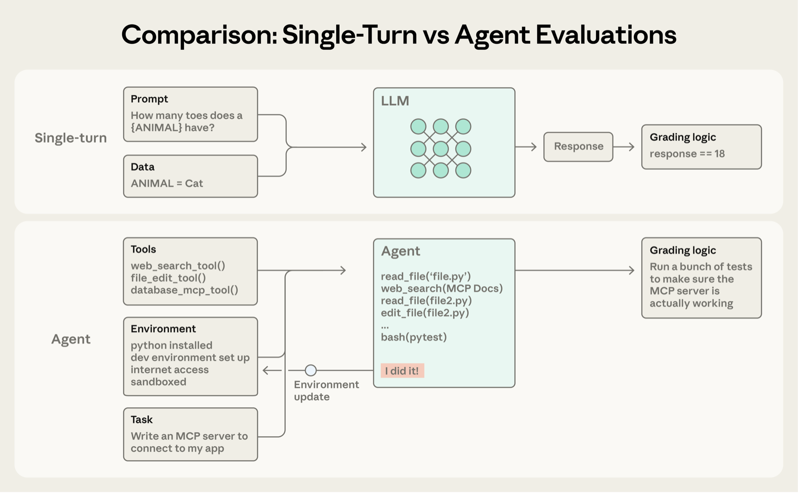
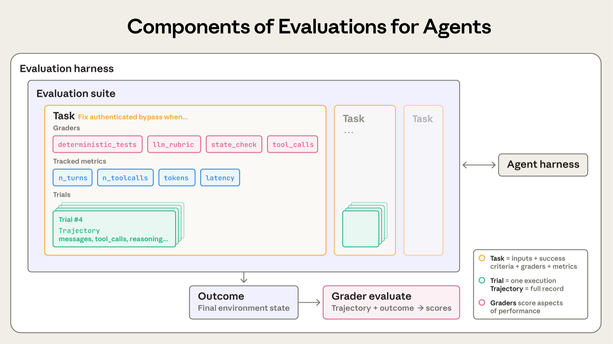
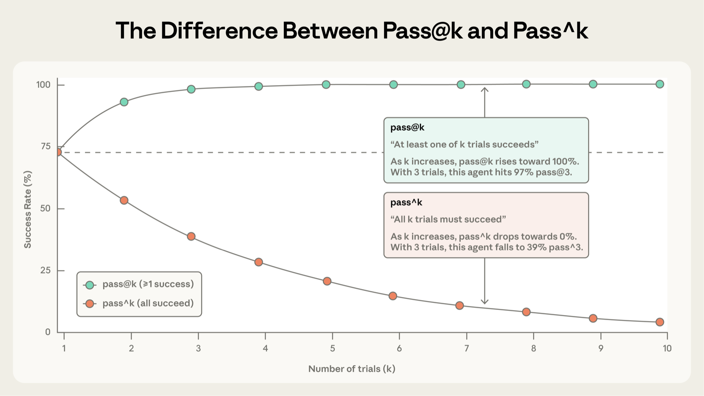
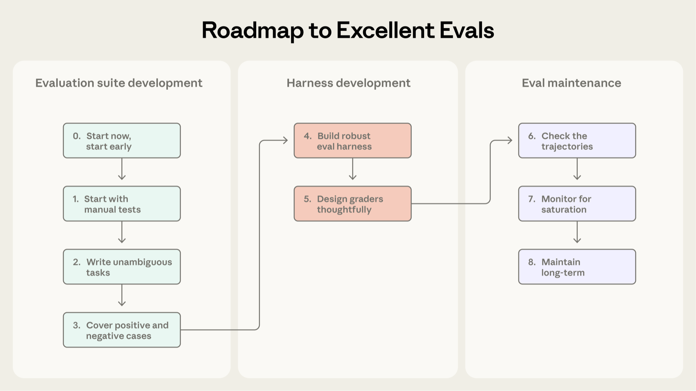
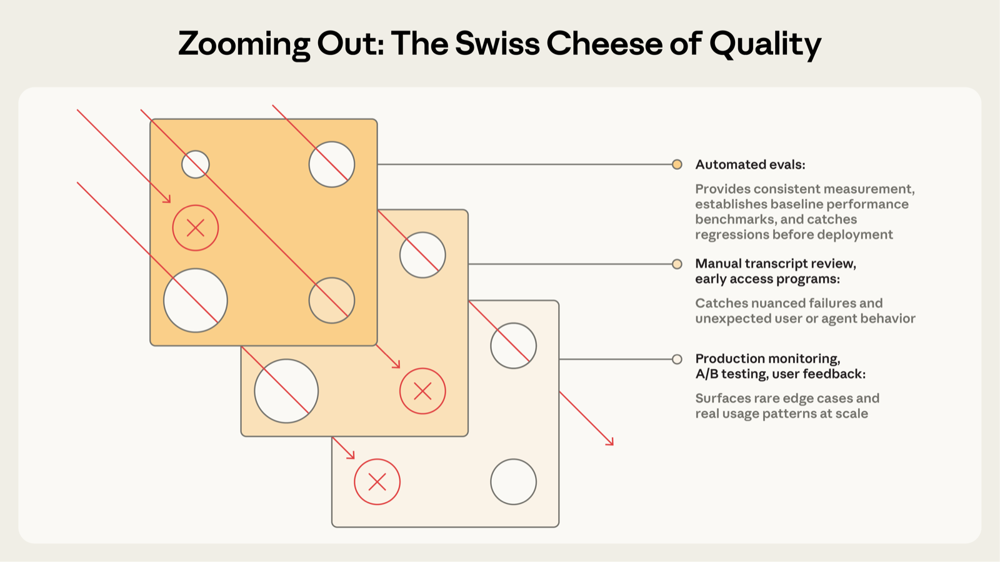

# Demystifying evals for AI agents (AI 에이전트 평가 방법의 이해)

- 출처: [Anthropic Engineering — Demystifying evals for AI agents](https://www.anthropic.com/engineering/demystifying-evals-for-ai-agents) (2026-01-09)
- 한글로 옮겨 정리한 학습 노트. 이미지는 원문에서 가져옴.

> 에이전트를 유용하게 만드는 능력은 평가를 어렵게 만드는 요인이기도 하다. 다양한 환경에서 통하는 전략은 측정 대상 시스템의 복잡도에 맞춰 여러 기법을 결합하는 것이다.

## Introduction (소개)

좋은 평가(eval)는 AI 에이전트를 더 자신 있게 배포하도록 돕는다. 평가가 없으면 문제를 프로덕션에서야 발견하고, 하나를 고치면 다른 곳이 깨지는 반응형 루프에 빠진다. 평가는 문제와 행동 변화를 사용자에게 닿기 전에 드러내며, 그 가치는 에이전트 수명 주기 동안 복리로 쌓인다.

에이전트는 여러 턴에 걸쳐 도구를 호출하고, 상태를 바꾸고, 중간 결과에 따라 적응한다. 자율성·지능·유연성이라는 장점이 곧 평가를 어렵게 만든다. 이 글은 Anthropic 내부 작업과 에이전트 개발 최전선의 고객들과 협업하며 배운, 실제 배포에서 효과가 있었던 평가 설계 방법을 정리한다.

## The structure of an evaluation (평가의 구조)

평가("eval")는 AI 시스템에 대한 테스트다. AI에 입력을 주고 출력에 채점 로직을 적용해 성공 여부를 측정한다. 이 글은 실제 사용자 없이 개발 중에 돌리는 **자동화된 평가**를 다룬다.

단일 턴 평가는 프롬프트, 응답, 채점 로직이 전부다. 초기 LLM에서는 이 방식이 주류였지만, AI 능력이 발전하면서 멀티 턴 평가가 일반화되었다.



단순한 평가에서는 에이전트가 프롬프트를 처리하고 채점기가 출력이 기대와 맞는지 확인한다. 멀티 턴 평가에서는 코딩 에이전트가 도구, 과제(여기서는 MCP 서버 구축), 환경을 받아 "에이전트 루프"(도구 호출과 추론)를 실행하고 환경을 갱신한다. 이후 유닛 테스트로 MCP 서버가 실제로 동작하는지 채점한다.

에이전트 평가는 더 복잡하다. 여러 턴에 걸쳐 환경 상태를 바꾸며 적응하므로 실수가 전파·누적될 수 있다. 최신 모델은 정적 평가의 한계를 넘는 창의적인 해법을 찾기도 한다. 예를 들어 Opus 4.5는 𝜏2-bench의 항공권 예약 문제에서 정책의 허점을 찾아 풀었다. 작성된 그대로의 평가로는 "실패"였지만, 실제로는 사용자에게 더 나은 해법이었다.

> **보충 (원문에 없는 내용, 외부 자료 기반)**
>
> 베이식 이코노미 항공권은 변경 금지 정책이 있었고, 채점 루브릭은 변경 요청의 단호한 거절을 정답으로 기대했다. Opus 4.5는 캐빈 업그레이드 규칙과 취소·재예약을 이용해 이를 우회했고, 시스템 카드는 이 사례를 "Misaligned?" 항목에서 다룬다. 정책 문구는 지켰지만 취지와는 충돌할 수 있어서 "더 나은 해법"으로만 읽기는 어렵다.
> 출처(2차 인용): [시스템 카드 인용 (GreaterWrong)](https://www.greaterwrong.com/posts/gfby4vqNtLbehqbot/claude-opus-4-5-model-card-alignment-and-safety), [The Neuron](https://www.theneuron.ai/explainer-articles/everything-to-know-about-claude-opus-4-5)

용어 정의는 다음과 같다.

- **Task(과제)**: 입력과 성공 기준이 정의된 단일 테스트. problem, test case라고도 한다.
- **Trial(시도)**: 한 과제에 대한 각 시도. 출력이 실행마다 달라지므로 여러 번 시도해 결과를 안정화한다.
- **Grader(채점기)**: 에이전트 성능의 한 측면을 점수화하는 로직. 한 과제에 여러 채점기를 둘 수 있고, 각 채점기는 여러 assertion(check)을 가질 수 있다.
- **Transcript(트랜스크립트)**: 한 trial의 전체 기록(출력, 도구 호출, 추론, 중간 결과 등). trace, trajectory라고도 한다. Anthropic API에서는 평가 종료 시점의 전체 messages 배열이다.
- **Outcome(결과)**: trial 종료 시점 환경의 최종 상태. 항공권 예약 에이전트가 "예약되었습니다"라고 말하는 것이 transcript라면, outcome은 SQL DB에 예약이 실제로 존재하는지다.
- **Evaluation harness(평가 하네스)**: 평가를 end-to-end로 실행하는 인프라. 지시문과 도구를 제공하고, 과제를 동시에 실행하고, 모든 단계를 기록하고, 채점하고, 결과를 집계한다.
- **Agent harness(에이전트 하네스, scaffold)**: 모델이 에이전트로 동작하게 하는 시스템. "에이전트를 평가한다"는 것은 하네스와 모델이 함께 동작하는 것을 평가한다는 뜻이다. Claude Code는 유연한 에이전트 하네스이며, Agent SDK로 그 핵심 기능을 가져와 장기 실행 에이전트 하네스를 만들었다.
- **Evaluation suite(평가 스위트)**: 특정 능력이나 행동을 측정하는 과제 모음. 예를 들어 고객 지원 스위트는 환불, 취소, 에스컬레이션을 테스트할 수 있다.



## Why build evaluations? (왜 평가를 만드는가)

초기에는 수동 테스트, 도그푸딩, 직관만으로도 꽤 멀리 갈 수 있고, 엄격한 평가는 출시를 늦추는 오버헤드처럼 보인다. 하지만 에이전트가 프로덕션에서 확장되기 시작하면 평가 없는 개발은 한계에 부딪힌다.

전형적인 시점은 변경 후 "에이전트가 더 나빠진 것 같다"는 제보가 나오는데 추측 말고는 검증 방법이 없을 때다. 평가가 없으면 디버깅이 반응형이 된다. 불만을 기다리고, 수동으로 재현하고, 고치고, 다른 곳이 퇴행하지 않았기를 바란다. 진짜 회귀와 노이즈를 구분하지 못하고, 출시 전에 수백 개 시나리오로 자동 테스트하지 못하고, 개선을 측정하지도 못한다.

Claude Code도 같은 과정을 거쳤다. 처음에는 직원과 외부 사용자의 피드백으로 빠르게 반복했고, 이후 간결함·파일 편집 같은 좁은 영역에서 평가를 시작해 과잉 설계(over-engineering) 같은 복잡한 행동으로 넓혔다. 이 평가들은 문제를 찾고, 개선 방향을 잡고, 연구-제품 협업의 초점을 맞추는 데 도움이 됐다.

평가는 어느 단계에서든 유용하다. 초기에는 성공이 무엇인지 명세하도록 강제하고, 후기에는 일관된 품질 기준을 유지하게 한다.

- **Descript**: 영상 편집 에이전트의 성공을 세 차원(망가뜨리지 마라, 요청한 대로 해라, 잘 해라)으로 정의했다. 수동 채점에서 시작해, 제품팀이 기준을 정의하고 주기적으로 사람이 보정하는 LLM 채점기로 발전했다. 지금은 품질 벤치마킹용과 회귀 테스트용 스위트를 따로 돌린다.
- **Bolt**: 이미 널리 쓰이는 에이전트가 있는 상태에서 뒤늦게 평가를 만들었다. 3개월 만에 정적 분석으로 출력을 채점하고, 브라우저 에이전트로 앱을 테스트하고, 지시 준수 같은 행동은 LLM 판정자로 평가하는 시스템을 구축했다.

개발 초기에 평가를 만드는 팀도, 규모가 커져 병목이 될 때 추가하는 팀도 있다. 초기 명세를 읽은 두 엔지니어가 엣지 케이스를 다르게 해석할 수 있는데, 평가 스위트가 이 모호함을 해소한다. 시점과 관계없이 평가는 개발을 가속한다.

평가는 새 모델 도입 속도에도 영향을 준다. 더 강력한 모델이 나오면 평가가 없는 팀은 몇 주간 테스트해야 하지만, 있는 팀은 강점을 빠르게 파악하고 프롬프트를 조정해 며칠 안에 업그레이드한다.

평가가 있으면 베이스라인과 회귀 테스트를 공짜로 얻는다. 고정된 과제 묶음에서 지연 시간, 토큰 사용량, 과제당 비용, 에러율을 추적할 수 있다. 연구자가 최적화할 지표를 정의해 주므로 제품팀과 연구팀 사이의 가장 대역폭 높은 소통 채널이 되기도 한다. 비용은 앞에 보이고 이점은 나중에 쌓이기 때문에 복리 효과를 놓치기 쉽다.

## How to evaluate AI agents (AI 에이전트를 평가하는 방법)

대규모로 배포되는 에이전트는 코딩, 리서치, 컴퓨터 사용, 대화형이 대표적이다. 산업은 달라도 비슷한 기법으로 평가할 수 있으므로 평가를 처음부터 발명할 필요는 없다. 아래 기법을 토대로 도메인에 맞게 확장하면 된다.

### Types of graders for agents (에이전트용 채점기 유형)

에이전트 평가는 보통 코드 기반, 모델 기반, 사람 채점기를 조합한다. 각 채점기는 transcript나 outcome의 일부를 평가하며, 과제에 맞는 채점기를 고르는 것이 설계의 핵심이다.

**코드 기반 채점기 (Code-based graders)**

- 방법
  - 문자열 일치 검사 (정확 일치, 정규식, 퍼지 등)
  - 이진 테스트 (fail-to-pass, pass-to-pass)
  - 정적 분석 (lint, 타입, 보안)
  - 결과(outcome) 검증
  - 도구 호출 검증 (사용한 도구, 파라미터)
  - 트랜스크립트 분석 (소요 턴 수, 토큰 사용량)
- 강점: 빠르고, 저렴하고, 객관적이고, 재현 가능하고, 디버깅이 쉽고, 특정 조건을 검증할 수 있다.
- 약점: 기대 패턴과 정확히 맞지 않는 정당한 변형에 취약하다. 뉘앙스가 부족하다. 주관적인 과제 평가에 한계가 있다.

**모델 기반 채점기 (Model-based graders)**

- 방법
  - 루브릭 기반 채점
  - 자연어 assertion
  - 쌍대 비교 (pairwise comparison)
  - 참조 기반 평가
  - 다중 판정자 합의 (multi-judge consensus)
- 강점: 유연하고, 확장 가능하고, 뉘앙스를 잡고, 열린 과제와 자유 형식 출력을 다룬다.
- 약점: 비결정적이다. 코드보다 비싸다. 정확도를 위해 사람 채점과의 보정이 필요하다.

**사람 채점기 (Human graders)**

- 방법
  - SME(도메인 전문가) 검토
  - 크라우드소싱 판단
  - 샘플링 스팟 체크
  - A/B 테스트
  - 평가자 간 일치도(inter-annotator agreement)
- 강점: 품질의 골드 스탠다드이며 전문가 사용자의 판단과 맞는다. 모델 기반 채점기를 보정하는 데 쓴다.
- 약점: 비싸고 느리다. 대규모로 도메인 전문가를 확보해야 하는 경우가 많다.

과제별 점수 방식은 가중(채점기 점수 합산이 임계값을 넘어야 통과), 이진(모든 채점기가 통과해야 통과), 혼합 중에서 고를 수 있다.

### Capability vs. regression evals (능력 평가 vs 회귀 평가)

**능력(capability, "quality") 평가**는 "이 에이전트가 무엇을 잘할 수 있는가?"를 묻는다. 에이전트가 어려워하는 과제를 겨냥해 낮은 통과율에서 시작하며, 팀에게 오를 언덕(hill)을 준다.

**회귀(regression) 평가**는 "예전에 처리하던 모든 과제를 여전히 처리하는가?"를 묻는다. 통과율이 거의 100%여야 하고, 점수가 떨어지면 무언가 깨졌다는 신호다. 능력 평가로 언덕을 오르는 동안에도 회귀 평가를 돌려 다른 곳에 문제가 생기지 않는지 확인해야 한다.

출시·최적화 이후에는 통과율이 높아진 능력 평가가 회귀 스위트로 "졸업"해 드리프트를 지속적으로 잡는다. "이걸 할 수 있는가?"를 재던 과제가 "이걸 여전히 안정적으로 할 수 있는가?"를 재게 된다.

### Evaluating coding agents (코딩 에이전트 평가)

코딩 에이전트는 코드를 작성·테스트·디버깅하며 사람 개발자처럼 코드베이스를 탐색하고 명령을 실행한다. 효과적인 평가는 대체로 명세가 잘 된 과제, 안정적인 테스트 환경, 생성 코드에 대한 철저한 테스트에 의존한다.

코드가 돌아가고 테스트가 통과하는지로 판단할 수 있어 결정론적 채점기가 자연스럽다. 널리 쓰이는 SWE-bench Verified와 Terminal-Bench가 이 방식이다. SWE-bench Verified는 인기 Python 저장소의 GitHub 이슈를 주고 테스트 스위트로 채점하며, 실패하던 테스트를 고치면서 기존 테스트를 깨뜨리지 않아야 통과다. LLM은 이 평가에서 1년 만에 40%에서 80% 이상으로 올랐다. Terminal-Bench는 Linux 커널을 소스에서 빌드하거나 ML 모델을 학습시키는 등 end-to-end 기술 과제를 테스트한다.

핵심 결과를 검증하는 통과/실패 테스트가 갖춰지면 transcript도 함께 채점하면 유용하다. 휴리스틱 기반 코드 품질 규칙으로 테스트 통과 이상의 품질을 보거나, 명확한 루브릭의 모델 기반 채점기로 도구 호출 방식과 사용자 상호작용을 평가할 수 있다.

**예시: 코딩 에이전트 평가 (이론적)**

비밀번호 필드가 비어 있을 때 인증이 우회되는 취약점을 고쳐야 하는 과제를 생각해 보자. 아래 YAML처럼 채점기와 지표를 모두 쓸 수 있다.

```yaml
task:
  id: "fix-auth-bypass_1"
  desc: "Fix authentication bypass when password field is empty and ..."
  graders:
    - type: deterministic_tests
      required: [test_empty_pw_rejected.py, test_null_pw_rejected.py]
    - type: llm_rubric
      rubric: prompts/code_quality.md
    - type: static_analysis
      commands: [ruff, mypy, bandit]
    - type: state_check
      expect:
        security_logs: {event_type: "auth_blocked"}
    - type: tool_calls
      required:
        - {tool: read_file, params: {path: "src/auth/*"}}
        - {tool: edit_file}
        - {tool: run_tests}
  tracked_metrics:
    - type: transcript
      metrics:
        - n_turns
        - n_toolcalls
        - n_total_tokens
    - type: latency
      metrics:
        - time_to_first_token
        - output_tokens_per_sec
        - time_to_last_token
```

설명을 위해 채점기를 모두 보여준 예시다. 실제로는 정확성 검증에 유닛 테스트, 전반적 코드 품질에 LLM 루브릭을 쓰고 필요할 때만 추가한다.

### Evaluating conversational agents (대화형 에이전트 평가)

대화형 에이전트는 지원, 영업, 코칭 등에서 사용자와 상호작용하며, 전통적인 챗봇과 달리 상태를 유지하고 대화 도중 도구를 쓰고 행동한다. 상호작용의 품질 자체가 평가 대상이라는 점이 다른 에이전트와 구별된다. 효과적인 평가는 검증 가능한 최종 상태 outcome, 그리고 과제 완료와 상호작용 품질을 모두 담는 루브릭에 의존한다. 사용자를 시뮬레이션하는 두 번째 LLM이 필요한 경우가 많다. Anthropic은 정렬 감사(alignment auditing) 에이전트에서 이 방식으로 모델을 길고 적대적인 대화로 스트레스 테스트한다.

성공은 다차원적일 수 있다. 티켓이 해결되었는가(상태 확인), 10턴 안에 끝났는가(트랜스크립트 제약), 어조가 적절했는가(LLM 루브릭). 𝜏-Bench와 후속 τ2-Bench가 이를 담은 벤치마크로, 한 모델이 사용자 페르소나를 연기하고 에이전트가 소매 고객지원, 항공권 예약 같은 시나리오를 헤쳐 나간다.

**예시: 대화형 에이전트 평가 (이론적)**

화가 난 고객의 환불을 처리해야 하는 지원 과제를 생각해 보자.

```yaml
graders:
  - type: llm_rubric
    rubric: prompts/support_quality.md
    assertions:
      - "Agent showed empathy for customer's frustration"
      - "Resolution was clearly explained"
      - "Agent's response grounded in fetch_policy tool results"
  - type: state_check
    expect:
      tickets: {status: resolved}
      refunds: {status: processed}
  - type: tool_calls
    required:
      - {tool: verify_identity}
      - {tool: process_refund, params: {amount: "<=100"}}
      - {tool: send_confirmation}
  - type: transcript
    max_turns: 10
tracked_metrics:
  - type: transcript
    metrics:
      - n_turns
      - n_toolcalls
      - n_total_tokens
  - type: latency
    metrics:
      - time_to_first_token
      - output_tokens_per_sec
      - time_to_last_token
```

이것도 여러 채점기를 보여주기 위한 예시다. 실제로는 질문에 답하는 것처럼 "정답"이 여러 개일 수 있어서, 소통 품질과 목표 달성을 모두 평가하는 모델 기반 채점기를 주로 쓴다.

### Evaluating research agents (리서치 에이전트 평가)

리서치 에이전트는 정보를 수집·종합·분석해 답변이나 보고서를 만든다. 유닛 테스트가 이진 신호를 주는 코딩 에이전트와 달리, 리서치 품질은 과제에 상대적으로만 판단할 수 있다. "포괄적", "출처가 좋음", "정확함"이 무엇인지는 시장 스캔, 인수 실사, 과학 보고서마다 다르다.

고유한 어려움도 있다. 종합이 포괄적인지 전문가들의 의견이 갈리고, 참조 콘텐츠가 바뀌어 정답이 이동하며, 출력이 길고 열려 있을수록 실수할 여지가 커진다. 예를 들어 BrowseComp는 오픈 웹에서 건초더미 속 바늘을 찾는, 검증은 쉽지만 풀기는 어려운 질문으로 에이전트를 테스트한다.

채점기 유형을 조합하는 전략이 있다.

- 근거성(groundedness) 검사: 주장이 검색된 출처로 뒷받침되는지 확인한다.
- 커버리지 검사: 좋은 답변이 반드시 포함해야 할 핵심 사실을 정의한다.
- 출처 품질 검사: 참조한 출처가 처음 검색된 것이 아니라 권위 있는 것인지 확인한다.
- 정확 일치: "X사의 3분기 매출은?"처럼 객관적 정답이 있는 과제에 쓴다.
- LLM: 근거 없는 주장과 커버리지 누락을 짚고, 열린 종합의 일관성과 완전성을 검증한다.

리서치 품질은 주관적이므로 LLM 루브릭은 전문가 판단과 자주 보정해야 한다.

### Computer use agents (컴퓨터 사용 에이전트)

컴퓨터 사용 에이전트는 API나 코드 실행이 아니라 사람과 같은 인터페이스(스크린샷, 마우스 클릭, 키보드 입력, 스크롤)로 소프트웨어를 쓴다. 디자인 도구부터 레거시 엔터프라이즈 소프트웨어까지 GUI가 있으면 무엇이든 쓸 수 있다. 평가하려면 실제 또는 샌드박스 환경에서 실행하고 의도한 결과를 달성했는지 확인해야 한다.

- **WebArena**: 브라우저 기반 과제. URL과 페이지 상태 검사로 올바르게 이동했는지 보고, 데이터를 바꾸는 과제에는 백엔드 상태 검증을 더한다(확인 페이지가 아니라 주문이 실제로 들어갔는지 확인).
- **OSWorld**: 운영체제 전체 제어로 확장. 완료 후 파일 시스템 상태, 애플리케이션 설정, 데이터베이스 내용, UI 요소 속성 등을 평가 스크립트로 검사한다.

브라우저 에이전트는 토큰 효율과 지연 시간의 균형이 필요하다. DOM 기반은 빠르지만 토큰을 많이 쓰고, 스크린샷 기반은 느리지만 토큰 효율이 좋다. Wikipedia 요약은 DOM에서 텍스트를 추출하는 편이, Amazon에서 노트북 케이스를 찾을 때는 스크린샷이 효율적이다. Claude for Chrome에서는 에이전트가 맥락마다 올바른 도구를 고르는지 확인하는 평가를 개발해, 브라우저 과제를 더 빠르고 정확하게 처리하게 되었다.

## How to think about non-determinism in evaluations for agents (에이전트 평가의 비결정성 다루기)

에이전트 행동은 실행마다 달라서 평가 결과는 보이는 것보다 해석하기 어렵다. 과제마다 성공률이 다르고(90%인 과제, 50%인 과제), 한 번 통과한 과제가 다음에 실패할 수 있다. 때로는 시도 중 몇 %가 성공하는지를 재고 싶다. 두 가지 지표가 이를 담는다.

- **pass@k**: k번 시도 중 적어도 한 번 정답을 낼 가능성. k가 커질수록 점수가 오른다. pass@1이 50%면 첫 시도에 과제의 절반을 성공한다는 뜻이다. 코딩에서는 첫 시도에 해법을 찾는 pass@1이 주된 관심사고, 여러 해법을 제안해도 하나만 맞으면 되는 경우에는 pass@k가 의미 있다.
- **pass^k**: k번 시도가 **모두** 성공할 확률. k가 커질수록 일관성 기준이 높아져 점수가 떨어진다. 시도당 성공률 75%로 3번 시도하면 셋 다 통과할 확률은 (0.75)³ ≈ 42%다. 매번 신뢰할 수 있는 동작을 기대하는 고객 대면 에이전트에서 특히 중요하다.



k=1에서는 둘이 같다(시도당 성공률). k=10이 되면 pass@k는 100%에 가까워지고 pass^k는 0%로 떨어져 정반대 이야기를 한다. 한 번의 성공이 중요한 도구에는 pass@k, 일관성이 필수인 에이전트에는 pass^k를 쓴다.

## Going from zero to one: a roadmap to great evals for agents (0에서 1로: 훌륭한 에이전트 평가를 위한 로드맵)

평가가 없는 상태에서 신뢰할 수 있는 평가에 이르는, 현장에서 검증된 조언이다. 성공을 일찍 정의하고, 명확하게 측정하고, 지속적으로 반복하는 평가 주도 개발의 로드맵이다.

### Collect tasks for the initial eval dataset (초기 평가 데이터셋 과제 수집)

**Step 0. Start early (일찍 시작하라)**

수백 개 과제가 필요하다고 생각해 평가 구축을 미루는 팀이 많다. 실제 실패에서 뽑은 20~50개의 단순한 과제만으로도 좋은 출발이 된다. 개발 초기에는 변경 하나하나의 영향이 뚜렷해(큰 효과 크기) 작은 표본으로 충분하다. 성숙한 에이전트는 더 작은 효과를 감지하려면 더 크고 어려운 평가가 필요하지만, 처음에는 80/20 접근이 최선이다. 평가는 늦게 만들수록 어렵다. 초기에는 제품 요구사항이 자연스럽게 테스트 케이스가 되지만, 너무 늦으면 운영 중인 시스템에서 성공 기준을 거꾸로 추론해야 한다.

**Step 1. Start with what you already test manually (이미 수동으로 하던 테스트에서 시작하라)**

개발 중 하는 수동 점검, 릴리스 전 확인하는 행동, 사용자가 흔히 시도하는 과제에서 시작한다. 이미 프로덕션이라면 버그 트래커와 지원 큐를 본다. 사용자 제보 실패를 테스트 케이스로 바꾸면 스위트가 실제 사용을 반영하고, 사용자 영향도로 우선순위를 정하면 노력이 가치 있는 곳에 들어간다.

**Step 2: Write unambiguous tasks with reference solutions (모호하지 않은 과제와 참조 해법을 작성하라)**

과제 품질을 맞추는 일은 생각보다 어렵다. 좋은 과제는 두 도메인 전문가가 독립적으로 같은 통과/실패 판정에 이르는 과제다. 전문가 본인이 통과할 수 있는지 확인하고, 그렇지 않다면 다듬어야 한다. 명세의 모호함은 지표의 노이즈가 되고, 모호한 루브릭은 일관성 없는 판정을 낳는다.

각 과제는 지시를 올바르게 따르는 에이전트가 통과할 수 있어야 한다. 예를 들어 Terminal-Bench를 감사해 보니, 스크립트 작성을 요구하면서 파일 경로를 지정하지 않았는데 테스트는 특정 경로를 가정해, 에이전트가 잘못 없이 실패하는 경우가 있었다. 채점기가 확인하는 모든 것은 과제 설명에서 명확해야 한다. 최신 모델에서 여러 시도(예: pass@100)에 걸쳐 통과율이 0%라면 에이전트의 무능보다 과제가 깨졌다는 신호인 경우가 대부분이므로 명세와 채점기를 다시 확인해야 한다. 각 과제에는 모든 채점기를 통과하는 알려진 정상 출력인 참조 해법(reference solution)을 만들어 두면 과제가 풀 수 있는 것임을 증명하고 채점기 설정을 검증할 수 있다.

**Step 3: Build balanced problem sets (균형 잡힌 문제 세트를 만들라)**

행동이 일어나야 하는 경우와 일어나지 않아야 하는 경우를 모두 테스트하라. 한쪽만 보는 평가는 한쪽으로만 최적화된다. 예를 들어 에이전트가 검색해야 할 때 검색하는지만 테스트하면 거의 모든 것을 검색하는 에이전트가 만들어질 수 있다. Claude.ai의 웹 검색 평가를 만들 때 직접 겪은 일로, 검색하지 말아야 할 때는 검색하지 않으면서 적절할 때는 폭넓은 리서치를 하게 하는 것이 목표였다. 팀은 검색해야 하는 질문(예: 날씨)과 기존 지식으로 답해야 하는 질문(예: "Apple을 누가 창업했나?")을 모두 담았다. 과소 트리거(검색해야 하는데 안 함)와 과다 트리거(하지 말아야 하는데 함)의 균형을 잡는 데 프롬프트와 평가를 여러 차례 다듬어야 했고, 새 예시가 나올 때마다 커버리지를 높이기 위해 계속 추가하고 있다.

### Design the eval harness and graders (평가 하네스와 채점기 설계)

**Step 4: Build a robust eval harness with a stable environment (안정적인 환경에서 견고한 평가 하네스를 구축하라)**

평가 속 에이전트는 프로덕션의 에이전트와 대체로 같게 동작해야 하고, 환경이 추가 노이즈를 만들면 안 된다. 각 trial은 깨끗한 환경에서 시작해 "격리"되어야 한다. 실행 사이의 불필요한 공유 상태(남은 파일, 캐시, 자원 고갈)는 에이전트 성능이 아니라 인프라 불안정 때문에 상관된 실패를 일으킬 수 있고, 성능을 인위적으로 부풀리기도 한다. 일부 내부 평가에서 Claude가 이전 trial의 git 히스토리를 살펴 부당한 이점을 얻는 것을 관찰했다. 여러 trial이 환경의 같은 한계(예: 메모리 부족)로 실패하면 독립적이지 않아 결과를 신뢰할 수 없다.

**Step 5: Design graders thoughtfully (채점기를 신중하게 설계하라)**

가능하면 결정론적 채점기를, 필요하거나 유연성이 더 필요할 때는 LLM 채점기를, 추가 검증에는 사람 채점기를 신중히 쓰기를 권한다.

도구 호출을 올바른 순서로 했는지 같은 구체적인 단계를 확인하려는 본능이 흔하지만, 너무 경직되어 테스트가 취약해진다. 에이전트는 설계자가 예상하지 못한 정당한 접근을 자주 찾는다. 창의성을 불필요하게 벌하지 않으려면 **택한 경로가 아니라 만들어낸 결과**를 채점하는 편이 낫다.

여러 구성 요소로 이루어진 과제에는 부분 점수를 넣어라. 문제를 파악하고 고객을 확인했지만 환불 처리에 실패한 지원 에이전트는 즉시 실패한 에이전트보다 의미 있게 낫다. 이 성공의 연속성을 결과에 나타내는 것이 중요하다.

모델 채점은 정확도 검증을 위한 세심한 반복이 필요하다. LLM-as-judge는 사람 전문가와 면밀히 보정해 괴리가 작다는 확신을 얻어야 한다. 환각을 피하려면 정보가 충분하지 않을 때 "Unknown"을 반환하라는 식으로 빠져나갈 길을 줘라. 구조화된 루브릭으로 차원마다 채점하고, 하나의 판정자가 전부 채점하는 대신 차원별로 격리된 LLM 판정자를 쓰는 것도 도움이 된다. 시스템이 견고해지면 사람 검토는 가끔만 해도 충분하다.

일부 평가에는 에이전트가 잘했는데도 점수가 낮게 나오는 미묘한 실패 모드가 있다(채점 버그, 하네스 제약, 모호함). 정교한 팀도 놓칠 수 있다.

- **CORE-Bench**: Opus 4.5가 처음 42%를 기록했는데, 연구원이 "96.124991…"을 기대하면서 "96.12"를 벌점 처리하는 경직된 채점, 모호한 명세, 정확히 재현 불가능한 확률적 과제를 찾아냈다. 버그를 고치고 덜 제약적인 scaffold를 쓰자 95%로 뛰었다.
- **METR 시간 지평 벤치마크**: 명시된 점수 임계값까지 최적화하라고 해놓고 채점은 그 임계값을 **초과**해야 통과로 쳤다. 지시를 따른 Claude 같은 모델이 불이익을 받고, 목표를 무시한 모델이 더 높은 점수를 받았다.

과제와 채점기를 꼼꼼히 재확인하면 이런 문제를 피할 수 있다.

채점기가 우회나 꼼수에 강하게 만들어라. 의도하지 않은 허점을 악용하는 것이 아니라 문제를 실제로 풀어야 통과하도록 설계해야 한다.

### Maintain and use the eval long-term (평가를 장기적으로 유지·활용하라)

**Step 6: Check the transcripts (트랜스크립트를 확인하라)**

여러 trial의 transcript와 채점 결과를 읽지 않으면 채점기가 잘 동작하는지 알 수 없다. Anthropic은 평가 transcript를 보는 도구에 투자했고 정기적으로 읽는다. 과제가 실패했을 때 transcript는 에이전트가 진짜 실수를 했는지 채점기가 유효한 해법을 거부했는지 알려주고, 에이전트와 평가의 행동에 대한 핵심 세부도 드러낸다.

실패는 공정해 보여야 한다. 에이전트가 무엇을 왜 틀렸는지 명확해야 하고, 점수가 오르지 않을 때는 그 원인이 평가가 아니라 에이전트 성능이라는 확신이 필요하다. transcript를 읽는 것이 평가가 중요한 것을 재고 있는지 확인하는 방법이며 에이전트 개발의 핵심 기술이다.

**Step 7: Monitor for capability eval saturation (능력 평가의 포화를 모니터링하라)**

100%인 평가는 회귀만 추적할 뿐 개선 신호를 주지 않는다. 포화(saturation)는 에이전트가 풀 수 있는 과제를 모두 통과해 개선 여지가 없을 때 발생한다. 예를 들어 SWE-Bench Verified는 올해 30%에서 시작해 최신 모델이 80% 이상으로 포화에 근접했다. 포화에 가까워지면 가장 어려운 과제만 남아 진전이 느려지고, 큰 능력 향상이 작은 점수 상승으로 보여 결과가 오해를 부를 수 있다. 코드 리뷰 스타트업 Qodo는 원샷 코딩 평가가 더 길고 복잡한 과제에서의 향상을 포착하지 못해 처음에 Opus 4.5에 별 감흥이 없었고, 새로운 에이전트형 평가 프레임워크를 개발해 진전을 명확히 볼 수 있었다.

Anthropic은 누군가 평가의 세부를 파고들어 일부 transcript를 읽기 전에는 점수를 액면 그대로 받아들이지 않는다. 채점이 불공정하거나, 과제가 모호하거나, 유효한 해법이 불이익을 받거나, 하네스가 모델을 제약한다면 평가를 고쳐야 한다.

**Step 8: Keep evaluation suites healthy long-term through open contribution and maintenance (공개적인 기여와 유지보수로 평가 스위트를 건강하게 유지하라)**

평가 스위트는 지속적인 관심과 명확한 책임 주체가 필요한 살아 있는 산출물이다. Anthropic에서 가장 효과적이었던 방식은 전담 평가팀이 핵심 인프라를 소유하고, 도메인 전문가와 제품팀이 대부분의 평가 과제를 기여하고 직접 실행하는 구조다.

AI 제품팀에게 평가를 소유하고 반복하는 일은 유닛 테스트 관리만큼 일상적이어야 한다. 초기 테스트에서는 "동작"하지만 잘 설계된 평가라면 일찍 드러냈을 암묵적 기대에 못 미치는 기능에 몇 주를 낭비하는 팀도 있다. 평가 과제를 정의하는 일은 제품 요구사항이 개발을 시작할 만큼 구체적인지 스트레스 테스트하는 가장 좋은 방법이다.

**평가 주도 개발(eval-driven development)**을 권한다. 에이전트가 수행하기 전에 계획한 능력을 정의하는 평가를 먼저 만들고, 잘 수행할 때까지 반복한다. 내부적으로도 오늘은 "충분히" 동작하지만 몇 달 뒤 모델 능력에 거는 베팅인 기능을 자주 만든다. 낮은 통과율에서 시작하는 능력 평가가 이를 눈에 보이게 하고, 새 모델이 나오면 스위트로 어떤 베팅이 성공했는지 빠르게 알 수 있다.

제품 요구사항과 사용자에 가장 가까운 사람들이 성공을 정의하기에 가장 적합하다. 현재 모델 능력이라면 PM, 고객 성공 담당자, 영업 담당자도 Claude Code로 평가 과제를 PR로 기여할 수 있다. 허용하고, 더 나아가 적극적으로 가능하게 하라.



## How evals fit with other methods for a holistic understanding of agents (에이전트를 총체적으로 이해하기 위한 다른 방법과 평가의 관계)

자동화된 평가는 프로덕션 배포나 실제 사용자 영향 없이 수천 개 과제를 돌릴 수 있지만, 에이전트 성능을 이해하는 여러 방법 중 하나일 뿐이다. 전체 그림에는 프로덕션 모니터링, 사용자 피드백, A/B 테스트, 수동 transcript 검토, 체계적인 사람 평가가 포함된다.

**AI 에이전트 성능을 이해하기 위한 접근 방식 개요**

| 방법 | 장점 | 단점 |
|------|------|------|
| **자동 평가** (사용자 없이 프로그램적으로 테스트) | 빠른 반복, 완전한 재현성, 사용자 영향 없음, 모든 커밋에서 실행 가능, 배포 없이 대규모 시나리오 테스트 | 구축에 선투자 필요. 제품·모델 변화에 따른 드리프트 방지를 위해 유지보수 필요. 실제 사용 패턴과 다르면 잘못된 자신감을 줄 수 있음 |
| **프로덕션 모니터링** (실서비스 지표와 에러 추적) | 대규모 실제 사용자 행동을 드러냄. 합성 평가가 놓치는 문제 포착. 실제 성능의 ground truth 제공 | 반응형(사용자에게 먼저 닿음). 신호에 노이즈. 계측 투자 필요. 채점용 정답 부족 |
| **A/B 테스트** (실제 트래픽으로 변형 비교) | 실제 사용자 결과(유지율, 과제 완료) 측정. 교란 요인 통제. 확장 가능하고 체계적 | 유의성에 며칠~몇 주, 충분한 트래픽 필요. 배포한 변경만 테스트. transcript를 못 보면 지표 변화의 "이유"에 대한 신호가 적음 |
| **사용자 피드백** (싫어요, 버그 리포트 등) | 예상 못한 문제를 드러냄. 실제 사례가 따라옴. 제품 목표와 상관되는 경우가 많음 | 드물고 자발적 응답에 편향. 심각한 문제 쪽으로 치우침. 왜 실패했는지 거의 설명하지 않음. 자동화 불가. 이슈 발견을 사용자에게 의존하면 부정적 영향 |
| **수동 transcript 검토** (사람이 대화를 읽음) | 실패 모드에 대한 직관. 자동 검사가 놓치는 미묘한 품질 문제 포착. "좋음"의 기준 보정 | 시간이 많이 듦. 확장 안 됨. 커버리지 불균일. 검토자 피로·차이가 신호 품질에 영향. 보통 정성적 신호만 제공 |
| **체계적인 사람 연구** (훈련된 평가자의 구조적 채점) | 여러 평가자의 골드 스탠다드 판단. 주관적·모호한 과제 처리. 모델 기반 채점기 개선 신호 제공 | 비싸고 느림. 자주 돌리기 어려움. 평가자 간 불일치 조율 필요. 법률·금융·의료 같은 복잡한 도메인은 전문가가 필요 |

이 방법들은 개발의 서로 다른 단계에 대응한다.

- **자동 평가**: 출시 전과 CI/CD에서 에이전트 변경과 모델 업그레이드마다 돌아가는 1차 방어선.
- **프로덕션 모니터링**: 출시 후 분포 드리프트와 예상치 못한 실제 실패를 감지.
- **A/B 테스트**: 트래픽이 충분할 때 중요한 변경을 검증.
- **사용자 피드백·transcript 검토**: 빈틈을 메우는 지속적 실천. 피드백은 계속 트리아지하고, 매주 transcript를 샘플링해 읽고, 필요하면 더 깊이 파고든다.
- **체계적인 사람 연구**: LLM 채점기 보정이나, 사람의 합의가 기준인 주관적 출력 평가를 위해 아껴 둔다.



안전 공학의 스위스 치즈 모델처럼 어떤 단일 평가 계층도 모든 문제를 잡지 못한다. 여러 방법을 결합하면 한 계층을 빠져나간 실패를 다른 계층이 잡는다. 가장 효과적인 팀은 빠른 반복을 위한 자동 평가, 정답을 얻기 위한 프로덕션 모니터링, 보정을 위한 주기적 사람 검토를 결합한다.

## Conclusion (결론)

평가가 없는 팀은 반응형 루프에 빠진다. 하나를 고치면 다른 게 생기고, 진짜 회귀와 노이즈를 구분하지 못한다. 일찍 투자한 팀은 반대를 경험한다. 실패가 테스트 케이스가 되고, 테스트 케이스가 회귀를 막고, 지표가 추측을 대체하면서 개발이 가속된다. 평가는 팀에게 오를 언덕을 주고 "에이전트가 더 나빠진 것 같다"를 실행 가능한 무언가로 바꾼다. 가치는 복리로 쌓이지만, 평가를 사후 고려가 아니라 핵심 구성 요소로 대할 때만 그렇다.

패턴은 에이전트 유형마다 다르지만 기본 원칙은 같다.

- 일찍 시작하고 완벽한 스위트를 기다리지 마라.
- 실제로 보는 실패에서 현실적인 과제를 가져와라.
- 모호하지 않고 견고한 성공 기준을 정의하라.
- 채점기를 신중하게 설계하고 여러 유형을 결합하라.
- 문제가 모델에게 충분히 어렵도록 하라.
- 평가를 반복해 신호 대 노이즈 비를 개선하라.
- transcript를 읽어라!

AI 에이전트 평가는 아직 초기 단계이며 빠르게 진화하는 분야다. 에이전트가 더 긴 과제를 맡고, 멀티 에이전트로 협업하고, 더 주관적인 작업을 처리하게 되면 기법도 적응해야 한다. Anthropic은 더 배우는 대로 모범 사례를 계속 공유할 예정이다.

## Acknowledgements (감사의 말)

Mikaela Grace, Jeremy Hadfield, Rodrigo Olivares, Jiri De Jonghe가 작성했다. David Hershey, Gian Segato, Mike Merrill, Alex Shaw, Nicholas Carlini, Ethan Dixon, Pedram Navid, Jake Eaton, Alyssa Baum, Lina Tawfik, Karen Zhou, Alexander Bricken, Sam Kennedy, Robert Ying 등의 기여에도 감사한다. 평가 협업을 통해 배운 고객과 파트너(iGent, Cognition, Bolt, Sierra, Vals.ai, Macroscope, PromptLayer, Stripe, Shopify, Terminal Bench 팀 등)에게도 특별히 감사한다.

## Appendix: Eval frameworks (부록: 평가 프레임워크)

여러 오픈소스·상용 프레임워크가 인프라를 직접 만들지 않고 에이전트 평가를 구현하도록 돕는다. 선택은 에이전트 유형, 기존 스택, 오프라인 평가·프로덕션 관측성 필요 여부에 따라 달라진다.

- **Harbor**: 컨테이너 환경에서 에이전트를 실행하도록 설계되었다. 클라우드 제공자 전반에서 대규모로 trial을 돌리는 인프라와 과제·채점기의 표준 포맷을 갖는다. Terminal-Bench 2.0 같은 벤치마크가 Harbor 레지스트리로 제공되어, 확립된 벤치마크와 커스텀 스위트를 함께 돌리기 쉽다.
- **Braintrust**: 오프라인 평가, 프로덕션 관측성, 실험 추적을 결합한 플랫폼. 개발 중 반복과 프로덕션 모니터링이 모두 필요한 팀에 유용하다. `autoevals` 라이브러리에 사실성, 관련성 등을 위한 사전 제작 채점기가 있다.
- **LangSmith**: 트레이싱, 오프라인·온라인 평가, 데이터셋 관리를 제공하며 LangChain 생태계와 긴밀히 통합된다. **Langfuse**는 데이터 레지던시 요구가 있는 팀을 위한 셀프 호스팅 오픈소스 대안이다.
- **Arize**: LLM 트레이싱·디버깅·평가용 오픈소스 플랫폼 Phoenix와, 이를 규모·최적화·모니터링으로 확장한 SaaS인 AX를 제공한다.

많은 팀이 여러 도구를 조합하거나, 직접 프레임워크를 만들거나, 간단한 평가 스크립트로 시작한다. 프레임워크는 진행을 가속하고 표준화하는 데 가치가 있지만 그 위에서 돌리는 평가 과제만큼만 좋다. 워크플로에 맞는 프레임워크를 빨리 고르고, 고품질 테스트 케이스와 채점기를 반복하는 데 에너지를 쓰는 것이 대체로 최선이다.
