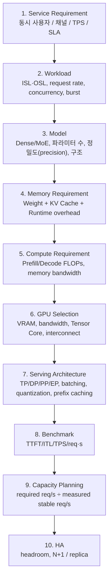
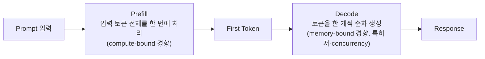
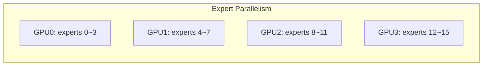
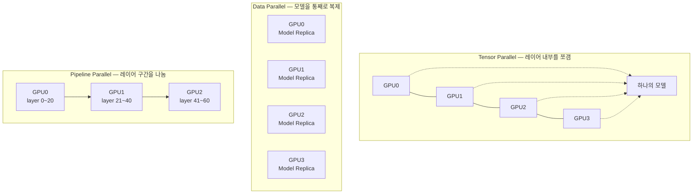
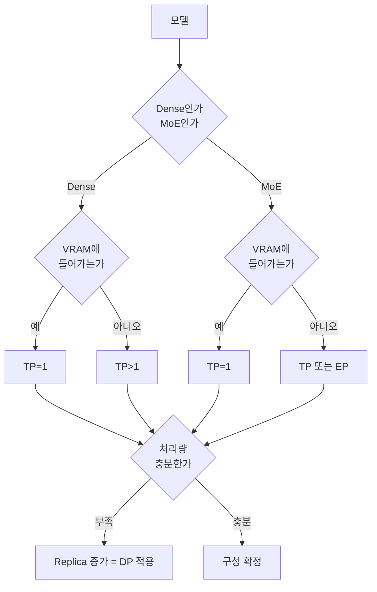
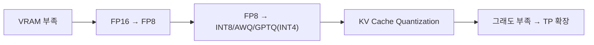
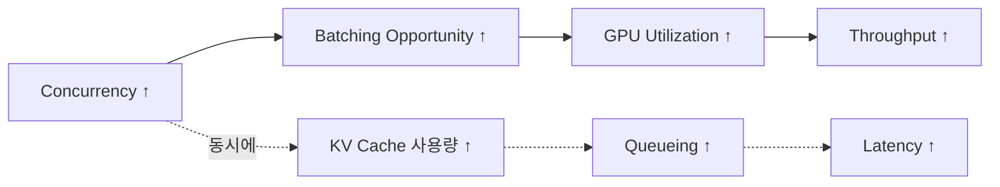
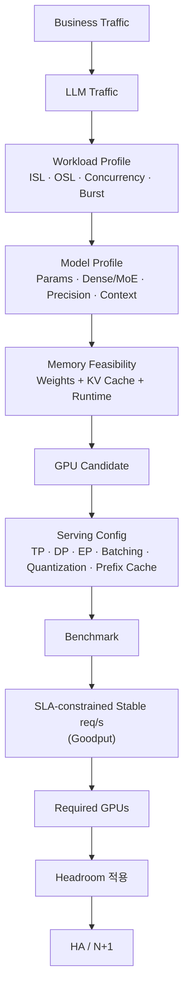

# 온프레미스 LLM GPU 사이징 & Serving Optimization Guide

> 참고: [vLLM Optimization and Tuning Guide](https://docs.vllm.ai/en/latest/configuration/optimization/), [vLLM Expert Parallel Deployment](https://docs.vllm.ai/en/latest/serving/expert_parallel_deployment/), [vLLM Data Parallel Deployment](https://docs.vllm.ai/en/stable/serving/data_parallel_deployment/), [vLLM Distributed Serving](https://docs.vllm.ai/en/v0.8.1/serving/distributed_serving.html), [vLLM Benchmark CLI](https://docs.vllm.ai/en/latest/benchmarking/cli/), [vLLM Paged Attention 설계 문서](https://docs.vllm.ai/en/latest/design/paged_attention/), [TensorRT-LLM FP8 Quantization Tuning](https://nvidia.github.io/TensorRT-LLM/performance/performance-tuning-guide/fp8-quantization.html), [NVIDIA H100 공식 사양](https://www.nvidia.com/ko-kr/data-center/h100/), [NVIDIA H200 공식 사양](https://www.nvidia.com/ko-kr/data-center/h200/), [NVIDIA RTX PRO 6000 Blackwell Server Edition 공식 사양](https://www.nvidia.com/ko-kr/data-center/rtx-pro-6000-blackwell-server-edition/)

## TL;DR — 산정 결과 보는 법

"이 기능에 GPU 몇 장 필요해요?"라는 질문에 답하려면 아래 다섯 가지가 먼저 정해져 있어야 한다. 이 문서 본문은 각 단계를 다루는 세부 설명이고, 이 섹션은 그 결과만 빠르게 훑는 용도다.

| 확인 항목 | 무엇을 봐야 하는가 | 관련 장 |
|---|---|---|
| **워크로드** | 기능이 몇 번, 얼마나 긴 입출력(ISL/OSL)으로 LLM을 호출하는가 | 1, 3장 |
| **모델** | Dense인지 MoE인지, 파라미터 수, 정밀도(FP16/FP8/INT4 등) | 5장, 0.3절 |
| **GPU 후보** | VRAM·대역폭·NVLink 유무가 워크로드에 맞는가 | 2장 |
| **서빙 구성** | TP/DP/PP/EP 중 무엇으로 확장할 것인가, 배치 크기 설정값 | 7, 6.3절 |
| **벤치마크 결과** | SLA(TTFT/ITL) 기준을 만족하는 GPU 1장당 실측 req/s | 8~10장 |

이 다섯 가지가 갖춰지면 마지막 계산은 한 줄이다.

```text
필요 GPU 수 = (필요한 LLM req/s ÷ GPU 1장당 실측 안정 req/s) × 헤드룸(1.2) × N+1
```

**산정 결과를 받았을 때 체크할 것**:
- req/s가 어떤 concurrency·ISL/OSL 조건에서 측정됐는지 (조건이 다르면 숫자를 그대로 못 씀)
- SLA(TTFT/ITL 기준)를 만족하는 조건에서 나온 수치인지 — 단순 최대 처리량이면 실사용 조건에서 못 씀 (10장 Goodput)
- 트래픽 환산 방식에 불확실성이 있다면 범위로 제시됐는지 (1.2절)
- 헤드룸과 이중화(N+1)가 반영된 최종 수치인지, 순수 계산치인지

세부 내용은 아래 0장(용어)부터 순서대로 읽거나, 표에서 필요한 장으로 바로 이동하면 된다.

---

## 전체 파이프라인 한눈에 보기

GPU 사이징을 "N billion 모델이니까 GPU 몇 장"으로 접근하면 안 된다. 아래 열 단계를 거쳐야 근거 있는 숫자가 나온다.



이 문서는 0장에서 핵심 용어를 정리하고, 이후 장에서 각 단계를 순서대로 다룬다.

---

## 0. 개념·용어 정리

이후 모든 장에서 반복 등장하는 용어를 한곳에 모아둔다. 처음 읽을 때는 훑고 넘어가고, 막히는 장이 있으면 다시 참고한다.

### 0.1 워크로드·트래픽

| 용어 | 의미 |
|---|---|
| **ISL (Input Sequence Length)** | 요청 하나의 입력 토큰 수. 프롬프트와 컨텍스트를 합친 길이 |
| **OSL (Output Sequence Length)** | 모델이 생성하는 출력 토큰 수 |
| **Concurrency (동시성, `c`)** | 특정 시점에 GPU가 동시에 처리 중인 요청 개수. 벤치마크에서 흔히 `c=25`처럼 고정해두고 측정 |
| **req/s** | 초당 처리 가능한 요청 수. GPU 1장의 처리 능력을 나타내는 핵심 지표 |
| **Burst (버스트)** | 평균 트래픽보다 순간적으로 크게 튀는 구간. 평균치만으로 사이징하면 이 구간에서 지연이 폭증함 |
| **Headroom (헤드룸)** | 평시 필요량보다 여유 있게 잡아두는 버퍼. 트래픽 변동·장애 대응·미래 증가분을 흡수 |

### 0.2 Latency 지표

TTFT/TPOT/ITL/E2E/P50-P99/Throughput/Goodput의 정의는 저장소 공통 [glossary.md의 "Latency 지표"](glossary.md#latency-지표) 참고. 이 문서에서 자주 쓰이는 건 TTFT(Prefill 성능 대변)와 ITL(Decode 성능 대변) 두 가지다.

### 0.3 모델·정밀도

| 용어 | 의미 |
|---|---|
| **Dense 모델** | 모든 파라미터가 매 추론마다 전부 사용되는 일반적인 모델 구조 |
| **MoE (Mixture of Experts)** | 여러 개의 expert 서브네트워크를 두고, 토큰마다 일부 expert만 선택적으로 활성화하는 구조. 전체 파라미터 수(total params)와 실제 연산에 쓰이는 파라미터 수(active params)가 다름. 표기는 흔히 `total-A active` 형태(예: 35B-A3B = 전체 35B 중 토큰당 3B만 활성화) |
| **Active Parameters** | MoE 모델에서 토큰 하나를 처리할 때 실제로 계산에 관여하는 파라미터 수. 메모리는 전체 파라미터 기준, 연산량은 active 파라미터 기준 |
| **Router / Gating Network** | MoE 모델에서 "이 토큰을 어떤 expert에게 보낼지" 결정하는 작은 서브네트워크. 매 토큰마다 상위 K개 expert를 선택(top-K routing) |
| **FP32** | 32bit 부동소수점, 4 byte/파라미터. 학습에 흔히 쓰이고 추론에서는 메모리 낭비가 커서 잘 안 씀 |
| **FP16 / BF16** | 16bit 부동소수점, 2 byte/파라미터. 비트 배치(지수부·가수부 비율)만 다르고 메모리 사용량은 동일. BF16은 지수 범위가 넓어 추론용 기본 정밀도로 널리 쓰임 |
| **FP8** | 8bit 부동소수점, 1 byte/파라미터, FP16 대비 메모리 절반. H100/H200 등은 FP8 연산을 하드웨어에서 가속 지원해 연산 속도 자체도 FP16 대비 약 2배로 빨라짐. INT8과 달리 부동소수점 형식이라 동적 범위 손실이 적어 품질 저하가 상대적으로 작음 |
| **INT8** | 8bit 정수, FP8과 메모리량은 같지만 스케일링(scale factor)이 필요. 비전·인코더 모델에는 INT8, LLM 디코더에는 FP8이 선호되는 경향 |
| **INT4** | 4bit 정수, 0.5 byte/파라미터, FP16 대비 메모리 75% 절감. 품질 저하가 가장 크지만(특히 복잡한 추론·수학) 요약·분류 등 단순 태스크에서는 실용적인 품질을 유지하는 경우가 많음 |
| **Quantization (양자화)** | 모델 가중치를 더 낮은 정밀도로 변환해 메모리·연산량을 줄이는 기법. AWQ, GPTQ, GGUF가 대표적 |
| **AWQ** | 활성화 패턴을 분석해 중요한 가중치는 보존하고 나머지만 공격적으로 양자화하는 INT4 계열 기법. 균일 양자화보다 품질 손실이 적어 INT4로 갈 때 우선 고려됨 |
| **GPTQ** | 레이어별로 가중치를 순차 양자화하며 오차를 보정하는 INT4 계열 기법. AWQ와 경쟁 관계 |
| **GGUF** | llama.cpp 계열 양자화 포맷. Q4_K_M 등 다양한 비트 수를 지원하며 CPU 추론·개인 워크스테이션 환경에서 많이 쓰임 |

### 0.4 GPU 하드웨어

| 용어 | 의미 |
|---|---|
| **VRAM (Video RAM)** | GPU 탑재 메모리 용량. 모델 가중치·KV 캐시·런타임 버퍼가 모두 여기 들어가야 하므로, 모델이 GPU에 들어가는지를 결정하는 1차 조건. 눈대중 기준 FP16은 파라미터 10억(1B)당 약 2GB, INT4는 약 0.5GB 필요 |
| **HBM (High Bandwidth Memory)** | GPU 다이 바로 옆에 수직으로 쌓아 올린 고대역폭 메모리. 데이터센터급 GPU(H100/H200 등)에 주로 탑재되며 HBM3, HBM3e로 세대가 올라감. GDDR보다 대역폭이 훨씬 높지만 단가가 비쌈 |
| **GDDR** | 일반 그래픽카드에도 흔히 쓰이는 메모리 규격(GDDR6, GDDR7 등). HBM보다 대역폭은 낮지만 저렴해서 보급형 워크스테이션·서버 GPU에 주로 채택됨 |
| **Memory Bandwidth** | VRAM과 연산 유닛 사이의 데이터 전송 속도(GB/s 또는 TB/s). Decode 단계 성능(초당 생성 토큰 수)을 좌우하는 핵심 지표 — 매 토큰 생성마다 모델 가중치 전체를 VRAM에서 읽어야 해서, 저-concurrency 상황에서는 TFLOPS보다 이 수치가 실제 속도를 더 잘 설명함 |
| **Tensor Core** | 행렬곱 연산 전용 GPU 유닛. Transformer 연산(Attention, FFN)의 핵심이며 데이터시트의 FP16/FP8/INT8 TFLOPS·TOPS 수치가 이 유닛의 성능치 |
| **CUDA Core** | 범용 병렬 연산 유닛. LLM 추론에서는 Tensor Core만큼 직접적인 지표는 아님 |
| **TFLOPS / TOPS** | 초당 부동소수점/정수 연산 횟수로 나타낸 이론적 연산 성능. 정밀도가 낮을수록 같은 하드웨어에서도 수치가 높게 나옴(예: FP8은 흔히 FP16의 약 2배) |
| **TDP (Thermal Design Power)** | GPU 최대 소비 전력. 서버 전력·냉각 설계에 필요 |
| **NVLink** | GPU-GPU 고속 직접 연결. PCIe보다 훨씬 높은 대역폭(예: 900GB/s급)을 제공해 여러 GPU로 모델을 나눌 때(TP 등) 통신 속도에 큰 영향 |
| **PCIe** | CPU-GPU 간, 또는 일부 GPU-GPU 간 연결에 쓰이는 범용 버스. NVLink보다 대역폭이 훨씬 낮음(예: Gen5 기준 128GB/s급) |
| **MIG (Multi-Instance GPU)** | GPU 1장을 여러 개의 독립된 작은 인스턴스로 물리 분할하는 기능. 여러 워크로드가 격리된 채로 나눠 쓸 때 활용 |

**NVLink는 병렬화 전략에 따라 필요 여부가 갈린다.**

- DP만 쓸 때: NVLink 없이 PCIe로도 무방 (GPU 간 통신이 거의 없음)
- TP를 쓸 때(모델이 GPU 1장에 안 들어가서 여러 장에 나눌 때): NVLink가 사실상 필수
- EP를 쓸 때: expert 간 토큰 라우팅으로 통신이 발생해 TP와 마찬가지로 NVLink 이점이 큼
- PP만 쓸 때: 레이어 구간 경계에서만 통신하므로 NVLink 없는 멀티노드 환경에서도 상대적으로 잘 동작함 (7장의 "TP는 노드 내, PP는 노드 간" 조합 원칙과 연결)

> TP는 레이어 하나를 계산할 때마다 GPU들이 부분 결과를 모아 합치는 연산(all-reduce)을 반복 수행한다. 토큰 하나를 생성하는 매 스텝마다, 그것도 레이어 수만큼(수십~수백 회) 이 통신이 발생한다. 이 통신이 PCIe(128GB/s급)처럼 느리면, 계산 자체는 GPU 여러 장에 잘 나눠 썼어도 GPU들이 서로 결과를 기다리느라 노는 시간이 늘어나 TP를 늘린 만큼 처리량이 못 따라오는 현상이 생긴다. NVLink(900GB/s급)는 이 all-reduce 구간을 짧게 만들어 TP의 통신 오버헤드를 실질적으로 줄여준다.

### 0.5 서빙(추론) 메커니즘

Prefill/Decode, KV Cache, PagedAttention, Continuous Batching, Chunked Prefill, Prefix Caching, Preemption 등 vLLM 내부 메커니즘 용어는 [glossary.md의 "Prefill / Decode"와 "KV Cache & PagedAttention"](glossary.md#prefill--decode) 절 참고. 이 문서에서 새로 추가하는 건 사이징 실무 파라미터 하나다.

| 용어 | 의미 |
|---|---|
| **`max_num_batched_tokens`** | 한 배치에서 한 번에 처리할 수 있는 최대 토큰 수. 작게 잡으면 ITL이, 크게 잡으면 TTFT가 유리해지는 트레이드오프 파라미터 (6.3절 상세) |

### 0.6 분산 서빙(병렬화)

TP/PP/DP/EP의 정의는 [glossary.md의 "분산 서빙 (병렬화)"](glossary.md#분산-서빙-병렬화) 참고. 7장은 정의를 반복하지 않고 "언제 어떤 병렬화를 택할지"에 집중한다.

### 0.7 용량 계획

| 용어 | 의미 |
|---|---|
| **Throughput (처리량)** | GPU·시스템이 낼 수 있는 최대 처리 능력(req/s, token/s) |
| **Goodput** | 단순 최대 처리량이 아니라 SLA(지연시간 기준 등)를 만족하며 처리 가능한 유효 처리량 |
| **SLA (Service Level Agreement)** | 서비스가 보장해야 하는 성능 기준(예: TTFT 1초 이내, ITL 50ms 이내) |
| **N+1 구성** | 필요한 replica 수보다 1개 더 여유 있게 두는 이중화 구성. 노드 1대가 죽어도 서비스가 최소 요구치를 유지하도록 함 |

---

## 1. 트래픽 → 필요 GPU 장수 환산

**결론**: 필요 GPU 수는 아래 한 줄로 계산한다.

```text
필요 GPU 수 = 필요한 LLM req/s ÷ GPU 1장당 안정 LLM req/s
```

"필요한 LLM req/s"는 단순 트래픽이 아니라 제품 단위(세션·메시지·평가) → 기능별 LLM 호출 횟수를 반영해 환산한 값이다.

### 1.1 제품 트래픽을 LLM req/s로 환산

제품마다 "1건의 사용자 행위"가 몇 번의 LLM 호출로 이어지는지가 다르므로, 이를 먼저 정의한다.

- **메시지 단위 제품**(예: 이커머스 챗봇): 메시지 1건당 여러 기능(질의 재작성, 답변 생성, 상품 추천 등)이 순차 호출될 수 있음 → 메시지당 최대 N회 호출로 계산
- **세션 단위 제품**(예: 음성 IVR 봇): 턴(turn)마다 의도분류 1회 + 특정 조건에서 시나리오분류 추가 호출 → "의도분류 호출률/턴", "시나리오분류 호출률/턴", "세션당 평균 턴 수"를 곱해 세션 단위 도착률로 환산
- **배치 평가 단위 제품**(예: 리뷰 자동 분류): 평가 1건당 평균 호출 횟수(상한 포함) 사용

세션 단위 도착률을 메시지율로 바꾸는 계산 예:
```text
메시지율 = 세션당 평균 메시지 수 ÷ 평균 세션 시간
         예) 18개 메시지 ÷ 210초 ≈ 0.086 메시지/s
```

### 1.2 조건별 확장 계산

실제로는 모든 케이스가 "메시지당 고정 호출"로 딱 떨어지지 않는다. 케이스를 나눠서 접근한다.

| 조건 | 상황 | 계산 방법 |
|---|---|---|
| 조건 1 | 전체 트래픽 중 일부 채널만 LLM을 탄다 | 전체 도착률 × LLM 타는 채널 비율 |
| 조건 2 | 세션이 끝난 뒤 1회성으로만 호출된다 | 메시지 단위가 아니라 세션 단위 도착률을 그대로 사용 |
| 조건 3 | 특정 조건을 만족하는 메시지에서만 호출된다 | 메시지량 × 적용 비율 × 호출 횟수 |
| 조건 4 | 구현 방식이 아직 미확정이다 | 세션 단위 vs 메시지 단위 계산값이 10배 이상 차이 날 수 있으므로 단일 수치가 아니라 범위(range)로 보고 |

조건 4 계산 예시:
```text
상담 메시지율 = 세션 도착률 × 메시지 발생 비율(가정 50%)
              ≈ 2.4 × 8.0 ≈ 19.2 메시지/s
신규 호출 req/s = 19.2 × 1회 ≈ 19.2
```

### 1.3 헤드룸과 N+1

- 순수 계산치에 헤드룸 20% 버퍼를 더해 최종 필요 장수를 산정한다.
- 이중화는 단순 여유 장수가 아니라 **N+1 원칙**을 따른다: 노드 1대가 장애로 빠져도 동기 응답이 필요한 제품은 순수 필요 replica 수를 유지하고, 비동기 허용 제품(예: 사후 평가)만 일시적 축소 운영을 감수하는 방식으로 노드별 배치를 설계한다.

이 장(트래픽 → GPU 장수)과 11장(HA/N+1)이 파이프라인의 앞뒤(트래픽 입력, 최종 배치)를 담당하고, 그 사이(2~9장: 워크로드를 모델·메모리·연산 요구량으로 변환해 GPU와 서빙 방식을 고르는 과정)를 이어서 다룬다.

---

## 2. GPU 하드웨어 스펙 읽는 법

**결론**: 데이터시트의 각 스펙은 LLM 추론에서 아래처럼 작동한다.

| Spec | 의미 | LLM Inference에서의 영향 |
|---|---|---|
| VRAM | GPU 메모리 용량 | 모델 크기, KV 캐시, 동시성 상한 결정 |
| Memory Bandwidth | VRAM ↔ 연산 유닛 데이터 전송 속도 | Decode 단계 성능(토큰 생성 속도) 좌우 |
| FP16/BF16 TFLOPS | 16bit 행렬 연산 성능 | FP16/BF16 서빙 시 연산 상한 |
| FP8 TFLOPS | FP8 행렬 연산 성능 | FP8 추론 시 연산 상한. H100/H200 등은 FP8 전용 하드웨어 가속 지원 |
| INT8 TOPS | INT8 정수 연산 성능 | INT8 양자화 모델 서빙 시 연산 상한 |
| CUDA Core | 범용 병렬 연산 유닛 | LLM에서는 Tensor Core만큼 직접적인 지표는 아님 |
| Tensor Core | 행렬곱 전용 연산 유닛 | Transformer 연산의 핵심, TFLOPS/TOPS 수치가 이 유닛의 성능 |
| TDP | 최대 소비 전력 | 서버 전력·냉각 설계 |
| PCIe | CPU-GPU 및 일부 GPU-GPU 통신 | NVLink보다 낮은 대역폭, multi-GPU 구성 시 병목 가능 |
| NVLink | GPU-GPU 고속 직접 연결 | TP/EP처럼 GPU 간 통신이 빈번한 구성에서 성능에 매우 중요 |

> TFLOPS 숫자만 비교하면 안 되는 이유는 실제 서빙 성능이 워크로드의 compute-bound·memory-bound 여부에 따라 병목 지점이 달라지기 때문이다. 저-concurrency 상황의 Decode는 memory bandwidth가 병목이 되기 쉬워서, FP16 TFLOPS가 더 높은 GPU라도 bandwidth가 낮으면 실제 토큰 생성 속도는 오히려 느릴 수 있다. 실제 벤치마크에서도 고사양 GPU가 보급형 GPU 대비 약 2배 수준의 처리량을 보인 사례가 있는데, 이 차이를 이해하려면 3장의 Prefill/Decode 구분이 필요하다.

### 2.1 H100 / H200 / RTX PRO 6000 스펙 비교

**결론**: 사이징에서 자주 비교 대상에 오르는 세 GPU의 공식 스펙은 다음과 같다.

| Spec | H100 SXM | H200 SXM | RTX PRO 6000 Blackwell (Server) |
|---|---|---|---|
| GPU 메모리 (VRAM) | 80 GB | 141 GB | 96 GB |
| 메모리 종류 | HBM3 | HBM3e | GDDR7 |
| 메모리 대역폭 | 3.35 TB/s | 4.8 TB/s | 1.597 TB/s |
| FP16/BF16 Tensor Core | 1,979 TFLOPS | 1,979 TFLOPS | 1,000 TFLOPS |
| FP8 Tensor Core | 3,958 TFLOPS | 3,958 TFLOPS | 2,000 TFLOPS |
| FP4 Tensor Core | 미지원 | 미지원 | 4,000 TFLOPS |
| INT8 Tensor Core | 3,958 TOPS | 3,958 TOPS | — (FP8/FP4 중심 세대) |
| TDP | 최대 700W | 최대 700W | 데이터시트 기준 별도 명시(공랭/수랭 옵션) |
| 인터커넥트 | NVLink 900GB/s, PCIe Gen5 128GB/s | NVLink 900GB/s, PCIe Gen5 128GB/s | PCIe Gen5 (NVLink 미지원) |
| MIG | 최대 7개, 각 10GB | 최대 7개, 각 18GB | 최대 4개 인스턴스 |

이 표에서 세 GPU의 성격이 분명히 갈린다.

- **H100 → H200**: 같은 Hopper 아키텍처라 Tensor Core 연산 성능(FP16/FP8 TFLOPS)은 동일하고, VRAM(80GB→141GB)과 대역폭(3.35→4.8TB/s)만 커졌다. H200은 "더 빠른 GPU"가 아니라 "같은 연산 성능에 메모리를 크게 키운 GPU"에 가깝다.
- **RTX PRO 6000**: HBM이 아니라 GDDR7이라 대역폭은 H100/H200의 1/3~1/2 수준이지만, VRAM 용량(96GB)은 H100보다 오히려 크고 가격은 저렴한 편이라 보급형 포지션에 있다. NVLink를 지원하지 않아 TP로 여러 장을 묶는 구성에는 원래 불리하다(0.4절 참고).
- Blackwell 세대(RTX PRO 6000)부터 FP4 Tensor Core가 생겼지만 Hopper 세대(H100/H200)는 FP4를 지원하지 않는다. 특정 정밀도로 양자화해 쓸 수 있는지는 정밀도 자체보다 GPU 세대가 그 정밀도의 하드웨어 가속을 지원하는지부터 확인해야 한다.

> 공식 자료가 밝힌 실측 효과 예시(Llama2 70B, ISL 2K/OSL 128 기준)로는 H200이 H100 대비 추론 처리량 약 1.9배다. 이 수치가 단순 FP16 TFLOPS 비율(위 표에서 보듯 H100과 H200은 TFLOPS가 동일)보다 훨씬 큰 이유는 VRAM이 커져서(80GB→141GB) 동일 GPU 1장에 더 많은 KV 캐시를 태울 수 있고, 그만큼 배치 크기(BS)를 키울 수 있었기 때문이다(공식 자료 각주에도 H100은 BS 8, H200은 BS 32로 비교했다고 명시). 처리량 향상의 상당 부분이 연산 성능이 아니라 메모리 용량 증가에서 나왔다는 걸 데이터시트만 봐도 유추할 수 있다 — 6장에서 다룰 KV 캐시 크기와 동시성의 관계를 미리 보여주는 사례다.

### 2.2 GPU 선택 기준

- **H100/H200**: NVLink 지원 + 높은 대역폭 + FP8 하드웨어 가속이 필요한 대형 모델(TP로 나눠야 하는 70B급 이상), 또는 KV 캐시를 크게 잡아야 하는 고동시성 서빙에 적합
- **RTX PRO 6000**: 단일 GPU에 모델이 들어가는 중소형(sLLM급, 4B~35B) 워크로드에서 비용 대비 처리량을 우선할 때. NVLink가 없으므로 TP 확장은 지양하고 DP(replica 복제)로 확장하는 전략이 자연스럽게 맞음

> 12장에서 보듯 H100/H200 같은 동급 아키텍처 GPU 간에도 공식 벤치마크 기준 처리량 차이가 30~90%대로 크게 갈린다. RTX PRO 6000처럼 아키텍처 자체가 다른 GPU와 비교할 때는 공식 수치를 참고선으로 삼되, 데이터시트만으로 결론 내지 않고 반드시 자체 워크로드로 벤치마크해 검증한다(8장 참고).

---

## 3. Prefill과 Decode

**결론**: LLM 추론은 성격이 다른 두 단계로 나뉜다.



- **Prefill**: 입력 토큰 전체를 한꺼번에 처리한다(예: ISL 10,000이면 10,000개 토큰을 한 번에). 연산 집약적이라 Tensor Core 성능이 중요하다.
- **Decode**: 토큰을 하나씩 순차 생성한다. 매 토큰마다 모델 가중치를 다시 읽어야 해서, 작은 배치 크기에서는 메모리 대역폭이 병목이 되기 쉽다.

**워크로드(ISL/OSL) 프로파일이 사이징에 중요한 이유**: 동일 모델이라도 ISL이 긴 워크로드와 짧은 워크로드는 병목 지점 자체가 다르다. 같은 제품 안에서도 기능마다(질의 재작성처럼 짧은 입력·짧은 출력인 기능, RAG 답변 생성처럼 긴 입력·중간 길이 출력인 기능 등) ISL/OSL이 수 배씩 차이 나는 경우가 흔하다.

"N billion 모델이니까 몇 req/s"라고 일반화할 수 없고, 실제 서비스의 ISL/OSL 분포를 기준으로 벤치마크해야 의미 있는 수치가 나온다.

---

## 4. 모델 메모리 계산

### 4.1 가중치 메모리

가장 기본적인 계산:
```text
Weight Memory ≈ Parameter Count × Bytes per Parameter
```

정밀도별 바이트 수:
```text
FP32       = 4 byte
FP16/BF16  = 2 byte
FP8/INT8   = 1 byte
INT4       = 0.5 byte
```

예: 35B 모델
```text
FP16:  35B × 2   ≈ 70 GB
FP8:   35B × 1   ≈ 35 GB
INT4:  35B × 0.5 ≈ 17.5 GB
```

양자화 메타데이터(scale factor 등)와 런타임 할당분이 있어서 실제 VRAM 사용량은 이보다 더 든다.

### 4.2 입문용 근사식과 한계

```text
VRAM ≈ 모델 가중치 + (컨텍스트 길이 × 동시 요청 수 기준 KV 캐시) × 1.3~2.0
```

이 식은 처음 감을 잡는 용도로는 괜찮지만, 실제 sizing 공식으로 쓰기엔 거칠다. KV 캐시는 컨텍스트 × 동시성만으로 결정되지 않고 모델의 레이어 수·KV head 수·head dimension·KV dtype에도 영향을 받는다(6장 상세 공식). 실제 서빙에서는 vLLM의 block allocation, CUDA graph, activation/temporary buffer도 VRAM을 차지한다.

---

## 5. Dense와 MoE

**결론**: Dense와 MoE는 메모리·연산 요구량의 결정 요인이 다르므로 별도로 이해해야 한다.

```text
Dense 27B
  total params  = 27B
  active params ≈ 27B   (모든 파라미터가 매번 연산에 관여)

MoE 35B-A3B
  total params  ≈ 35B
  active params ≈ 3B    (토큰마다 일부 expert만 활성화)
```

MoE는 메모리에는 전체 expert 가중치가 영향을 주지만, 토큰당 연산량에는 active parameter가 더 중요하다. "35B니까 27B보다 느리겠지"가 반드시 성립하지 않는다.

### 5.1 실제 벤치마크로 확인된 순위

**결론**: 동일 GPU 기준 실측 처리량(req/s, concurrency 고정) 순위는 다음과 같다.

```text
4B dense               : 가장 높은 처리량
35B-A3B MoE (FP8)      : 27B dense보다 높음, 4B dense보다는 낮음
35B-A3B MoE (FP16)     : MoE FP8보다 낮음
27B dense              : 가장 낮은 처리량
```

> 파라미터 총량이 아니라 active parameter와 정밀도가 처리량을 결정한다는 원칙이 실전에서 그대로 확인됐다. 모델 성능(품질) 면에서는 파라미터가 클수록 유리한 경향이 있으므로, 실제 선택은 처리량과 품질의 절충점을 벤치마크로 찾는 문제가 된다.

### 5.2 Expert Parallelism (EP)

MoE를 multi-GPU로 확장할 때는 TP/PP 외에 **EP(Expert Parallelism)**라는 선택지가 추가로 생긴다. expert들을 GPU마다 나눠 배치하는 방식으로, vLLM도 MoE 계열 모델에 대해 EP를 별도 지원한다.



---

## 6. KV Cache

**결론**: GPU 사이징에서 가장 자주 놓치는 부분이다.

### 6.1 계산 공식

```text
KV Cache ≈ 2 × num_layers × num_kv_heads × head_dim
            × sequence_length × concurrent_sequences
            × bytes_per_element
```

`2`는 Key와 Value 두 개를 저장하기 때문이다.

같은 모델·같은 GPU라도 컨텍스트 길이와 동시성 조합에 따라 필요 메모리가 완전히 달라진다.

```text
context 4K, concurrency 10   → 필요 메모리 A
context 32K, concurrency 100 → 필요 메모리 A와 전혀 다른 규모
```

"모델이 GPU에 들어간다"와 "그 GPU가 실제 프로덕션 트래픽을 처리한다"는 완전히 다른 문제다.

### 6.2 KV Cache 부족: Preemption

**결론**: KV 캐시가 부족하면 vLLM이 일부 요청을 preempt(일시 중단)한 뒤 나중에 recompute(재계산)한다. 이 현상이 잦으면 지연시간이 급격히 나빠지므로 아래 레버를 조정한다.

- `gpu_memory_utilization` 증가: vLLM이 미리 확보해두는 GPU 메모리 비율을 늘려 KV 캐시 공간 확보
- `max_num_seqs` / `max_num_batched_tokens` 감소: 배치당 동시 요청 수를 줄여 필요 KV 캐시 자체를 줄임
- `tensor_parallel_size` 증가: 모델 가중치를 GPU 여러 장에 나눠 각 GPU에 남는 메모리(=KV 캐시 공간)를 늘림. 과도한 동기화 오버헤드를 유발할 수 있음
- `pipeline_parallel_size` 증가: 모델 레이어를 GPU마다 나눠 GPU 1장당 가중치 메모리 부담을 줄이고 KV 캐시 여유 확보. 지연시간 패널티가 있을 수 있음

> 이 현상이 발생하면 아래 경고 로그가 찍힌다.
> ```text
> WARNING: Sequence group 0 is preempted by PreemptionMode.RECOMPUTE mode
> because there is not enough KV cache space. This can affect the
> end-to-end performance. Increase gpu_memory_utilization or
> tensor_parallel_size to provide more KV cache memory.
> total_cumulative_preemption_cnt=1
> ```
> vLLM V1에서는 기본 preemption 모드가 SWAP이 아니라 RECOMPUTE다(V1 아키텍처에서 재계산 오버헤드가 더 낮기 때문). Preemption 발생 횟수는 Prometheus 지표로 모니터링할 수 있고, `disable_log_stats=False`로 누적 횟수를 로그로도 남길 수 있다.

### 6.3 Chunked Prefill

**결론**: 긴 prefill을 작은 청크로 쪼개 decode 요청들과 함께 배치 처리하는 기능이다. Prefill(compute-bound)과 Decode(memory-bound)를 같은 배치에 섞으면 GPU 활용률의 균형을 더 잘 맞출 수 있다.

**`max_num_batched_tokens` 튜닝 가이드**:
- 작은 값(예: 2048): prefill이 decode를 덜 방해해 ITL이 좋아짐
- 큰 값: 배치당 더 많은 prefill 토큰을 처리해 TTFT가 좋아짐
- 처리량 최적화가 목적이라면, 특히 큰 GPU에서 작은 모델을 서빙할 때는 `max_num_batched_tokens > 8192` 권장
- Chunked prefill을 끄면 `max_num_batched_tokens`가 `max_model_len`보다 커야 하며, 그렇지 않으면 서버 시작 시 오류가 날 수 있음

```python
from vllm import LLM
llm = LLM(model="meta-llama/Llama-3.1-8B-Instruct", max_num_batched_tokens=16384)
```

TTFT와 ITL은 같은 파라미터(`max_num_batched_tokens`)를 놓고 트레이드오프 관계에 있다. 어느 쪽 SLA를 더 엄격하게 볼 것인지에 따라 값을 정한다(10장 Goodput 개념과 직결).

> vLLM V1에서는 가능하면 기본적으로 활성화된다. 스케줄링 정책은 decode 요청을 항상 우선 배치하고, `max_num_batched_tokens` 예산이 남으면 대기 중인 prefill을 채워 넣는다. Prefill 요청 하나가 예산에 다 안 들어가면 자동으로 청크 단위로 쪼갠다.

### 6.4 FP8 KV Cache

KV 캐시 자체를 FP8로 저장하는 최적화도 있다. KV 메모리를 줄이고 특정 워크로드에서 처리량을 크게 높인 사례가 보고되지만, 정확도 검증을 반드시 함께 수행해야 한다(TensorRT-LLM 공식 튜닝 가이드 권고사항).

### 6.5 Prefix Caching

**결론**: 여러 요청이 공유하는 프롬프트 앞부분(공통 system prompt 등)을 재계산하지 않고 KV 캐시에서 재사용하는 기능이다. 사이징 관점에서 효과는 두 가지다.

1. **Prefill 비용 절감 → TTFT 개선**: 공통 프리픽스 구간은 재계산이 생략돼 그만큼 Prefill 연산량이 줄어든다. 시스템 프롬프트가 길거나 특정 문서를 반복 참조하는 워크로드에서 TTFT 개선 폭이 크다.
2. **KV 캐시 메모리 요구량 증가**: 캐시를 재사용하려면 그만큼 오래 들고 있어야 하므로, "동시 요청 수 × 컨텍스트 길이"만으로 추산한 6.1절 공식보다 실제 필요한 캐시 총량이 늘어날 수 있다. 완전히 별개인 요청만 처리한다는 가정으로 사이징하면 공유 프리픽스가 많은 실제 워크로드에서 캐시 용량을 과소평가하게 된다.

기능별로 고정된 시스템 프롬프트나 공통 지시문을 매 요청 앞에 붙이는 구조라면, Prefix Caching이 실질적인 처리량 향상 레버가 될 수 있다. 모델·GPU를 바꾸지 않고도 프롬프트 설계(공통부를 앞에 고정)만으로 처리량을 올릴 여지가 있다는 뜻이므로, 8장의 "양자화 → TP" 완화 순서 앞에 "프롬프트 구조를 prefix-caching 친화적으로 재설계"를 우선 검토 항목으로 추가할 만하다.

> 상세 원리(블록 해싱 등)는 [[Inside vLLM Anatomy of a High-Throughput LLM Inference System|Inside vLLM]]의 "Prefix Caching" 절 참고. 벤치마크 시 데이터셋에 따라 프리픽스 공유 여부가 달라지므로, 프로덕션에서 프리픽스 캐싱 효과를 기대한다면 완전 랜덤 데이터셋만으로 측정한 처리량은 실제보다 낮게 나올 수 있다. vLLM Benchmark CLI는 이를 위해 별도의 Prefix Caching 전용 벤치마크(고정 프롬프트 반복, ShareGPT 기반, Prefix Repetition 데이터셋)를 제공한다.

---

## 7. 분산 서빙 — TP / DP / PP / EP



```text
TP → 모델 하나를 더 큰 GPU pool에서 실행 (모델이 안 들어갈 때)
PP → TP로도 부족한 초대형 모델을 레이어 단위로 추가 분산
EP → MoE 모델의 expert들을 GPU마다 분산
DP → 모델 replica를 늘려 트래픽 분산       (모델이 들어갈 때)
```

### Tensor Parallel (TP)

각 모델 레이어 내부에서 파라미터를 여러 GPU에 걸쳐 샤딩한다. 단일 노드 내 대형 모델 추론에 가장 흔히 쓰이는 전략이다.

**적용 시점**:
- 모델이 GPU 1장에 안 들어갈 때(예: 70B급 모델은 TP가 사실상 필수)
- GPU 1장당 메모리 압박을 줄여 KV 캐시 공간을 더 확보하고 싶을 때

```python
from vllm import LLM
llm = LLM(model="meta-llama/Llama-3.3-70B-Instruct", tensor_parallel_size=4)
```

GPU끼리 계속 통신해야 하므로 TP를 늘린다고 처리량이 선형으로 증가하지는 않는다.

### Pipeline Parallel (PP)

모델의 레이어들을 여러 GPU에 나눠 배치한다. 각 GPU가 서로 다른 구간을 순차 처리한다.

**적용 시점**:
- 이미 TP를 최대치까지 썼는데 모델을 더 분산해야 할 때(특히 여러 노드에 걸쳐서)
- 매우 깊고 좁은 모델 구조라 텐서 샤딩보다 레이어 단위 분산이 더 효율적일 때

```python
from vllm import LLM
llm = LLM(
    model="meta-llama/Llama-3.3-70B-Instruct",
    tensor_parallel_size=4,
    pipeline_parallel_size=2,
)
```

### Expert Parallel (EP)

MoE 모델 전용 특수 병렬화. 서로 다른 expert 네트워크들을 GPU마다 나눠 배치한다.

**적용 시점**:
- DeepSeekV3, Qwen3MoE, Llama-4 같은 MoE 계열 모델을 서빙할 때
- GPU 간 expert 연산 부하를 균형 있게 분산하고 싶을 때

`enable_expert_parallel=True`로 활성화하면 MoE 레이어에서 TP 대신 EP를 사용한다. 병렬화 정도는 TP에 설정한 값과 동일하게 적용된다.

### Data Parallel (DP)

모델 전체를 여러 GPU 세트에 걸쳐 통째로 복제하고, 서로 다른 요청 배치를 병렬로 처리한다.

**적용 시점**:
- 모델 전체를 복제할 만큼 GPU가 충분할 때
- 모델 크기가 아니라 처리량 자체를 확장하고 싶을 때
- 멀티 유저 환경에서 요청 배치 간 격리가 유리할 때

`data_parallel_size=N`으로 설정하며 다른 병렬화 전략과 함께 쓸 수 있다. MoE 레이어는 tensor parallel size × data parallel size의 곱만큼 샤딩된다.

### 멀티노드 조합

모델이 너무 커서 노드 하나에 안 들어가면 TP와 PP를 함께 쓴다: `tensor_parallel_size = 노드당 GPU 수`, `pipeline_parallel_size = 노드 수`.

---

## 8. 모델·GPU 조합 선택 — 의사결정 트리



메모리 부족 시 완화 순서는 다음과 같다.



> "양자화 → TP" 순서가 항상 정답은 아니다. 품질 요구사항, 하드웨어의 FP8 네이티브 지원 여부, 지연시간 목표, 모델별 양자화 지원 여부에 따라 `BF16 + TP2`와 `FP8 + TP1`을 실제로 벤치마크해서 비교 결정해야 하는 경우가 많다.

---

## 9. Concurrency와 Batching

**결론**: 동시성을 올리면 처리량은 늘지만 KV 캐시 사용량·큐잉·지연시간도 함께 늘어난다. 목표는 "최대 req/s"가 아니라 "SLA를 만족하면서 최대 req/s"다(10장 Goodput 참고).



벤치마크 시 concurrency는 보통 하나의 값이 아니라 여러 단계로 스윕(sweep)해서 봐야 한다. `c=25 → 50 → 100 → 200`처럼 늘려가며 ISL/OSL 조합 × 모델 × GPU 조합별로 아래 지표를 함께 관찰한다.

- Request throughput / Token throughput
- TTFT, TPOT (P50/P95/P99)
- ITL
- GPU utilization / VRAM usage
- KV cache utilization
- Preemption count

### 9.1 vLLM Benchmark CLI

**결론**: `vllm bench` CLI로 온라인(서버에 실제 요청을 쏘는 방식)/오프라인(배치로 한 번에 처리) 벤치마크를 모두 지원한다.

- 공식 문서는 이 도구를 vLLM 자체 기능 검증과 회귀 테스트 용도로 소개하며, 프로덕션 서버 벤치마킹에는 GuideLLM(실시간 진행 상황 표시·자동 리포트 생성을 지원하고 데이터셋 로딩·요청 포맷·워크로드 패턴 면에서 더 유연한 별도 프레임워크)을 함께 참고하도록 권장한다.
- **데이터셋 옵션**: ShareGPT(실제 대화 로그 기반), Random(합성 데이터, ISL/OSL을 직접 지정 가능), Prefix Repetition(프리픽스 캐싱 효과 측정용), 각종 HuggingFace 데이터셋(GSM8K, HumanEval 등). 사이징 목적이라면 Random 데이터셋으로 실제 서비스의 ISL/OSL 분포를 재현하는 게 가장 현실적이다.
- **측정 가능한 것**: Request/Token throughput, TTFT/TPOT/ITL 백분위수(P50/P95/P99), 구조화 출력(JSON/Grammar/Regex) 벤치마크, 프리픽스 캐싱 벤치마크, 임베딩/리랭커 벤치마크
- **Parameter Sweep**: concurrency·요청 속도 같은 파라미터를 여러 값으로 자동 스윕하며 측정하는 기능도 제공돼, `c=25 → 50 → 100 → 200` 같은 스윕을 수동 반복 없이 한 번에 돌릴 수 있다.

### 9.2 CPU 리소스 부족

**결론**: GPU 사이징에만 집중하다 놓치기 쉬운 게 CPU 코어 수다. vLLM V1은 멀티프로세스 아키텍처라 GPU를 아무리 잘 골라도 CPU가 부족하면 병목이 생긴다.

GPU N장 배포 시 최소 요구 프로세스:
- API 서버 프로세스 1개 — HTTP 요청, 토크나이징, 입력 처리
- 엔진 코어 프로세스 1개 — 스케줄러 실행, GPU 워커 조율
- GPU 워커 프로세스 N개 — GPU 1장당 1개, forward pass 실행

즉 최소 **물리 코어 2+N개**가 필요하다. 물리 코어보다 프로세스가 많으면 컨텐션이 발생해 처리량·지연시간이 크게 나빠지는데, 엔진 코어 프로세스는 busy loop를 돌기 때문에 CPU 부족에 특히 민감하다. 하이퍼스레딩 환경이면 `1 vCPU = 1/2 물리 코어`이므로 필요 vCPU는 `2 × (2+N)`이 된다.

DP를 쓰거나 API 서버를 여러 개 두면 요구량이 더 늘어난다:
```text
최소 물리 코어 = A + DP + N + (DP > 1이면 1)
```
(A = API 서버 개수(기본값은 DP와 동일), DP = data parallel size, N = 전체 GPU 수)

예: DP=4, TP=2, GPU 8장 구성이면 `API 서버 4개 + 엔진 코어 4개 + GPU 워커 8개 + DP 코디네이터 1개 = 17개 프로세스`가 CPU를 나눠 쓴다.

CPU가 부족하면 입력 처리(토크나이징, 채팅 템플릿 렌더링, 멀티모달 데이터 로딩), 스케줄링(새 토큰이 GPU 워커에 전달되는 속도), 출력 처리(디토크나이징, 스트리밍 응답)가 모두 느려진다. GPU 활용률이 기대보다 낮게 나온다면 CPU 컨텐션이 원인일 수 있으므로, 노드 스펙을 정할 때 CPU 코어 수도 GPU 개수에 맞춰 함께 산정한다.

---

## 10. Throughput vs Goodput

**결론**: 단순 최대 처리량만으로 GPU를 비교하면 안 된다.

```text
GPU A: 100 req/s, P99 TTFT = 8 sec
GPU B: 80 req/s,  P99 TTFT = 500 ms
```

단순 처리량으로는 A가 우세해 보이지만, 서비스 SLA가 `TTFT < 1 sec`, `ITL < 50 ms`라면 A의 100 req/s 중 상당수는 SLA를 만족하지 못하는 무효한 처리량이다. 실제 usable capacity는 오히려 B가 더 높을 수 있다.

```text
Throughput → 최대 처리량 (SLA 고려 안 함)
Goodput   → SLA를 만족하면서 처리 가능한 유효 처리량
```

용량 계획의 "GPU 1장당 안정 req/s"는 이 Goodput 기준으로 측정해야 한다. 단순 최대 처리량으로 계산하면 실제 서비스에서는 SLA 위반이 빈번한 상태로 운영하게 된다.

---

## 11. 전체 산정 파이프라인 — 확장판

1장의 "트래픽 → GPU 장수" 계산에 2~10장의 개념을 결합하면 아래처럼 전체 파이프라인이 완성된다.



A~C(제품 트래픽 → 워크로드 프로파일)와 I~L(용량 계획 → HA)은 1장의 방법론을 그대로 적용하면 되고, D~H(모델 프로파일 → 서빙 구성 → 벤치마크)는 2~10장에서 다룬 내용을 순서대로 적용하면 된다.

---

## 12. 공식 벤치마크로 보는 GPU 간 처리량 차이

**결론**: GPU 등급 간 처리량 차이는 데이터시트의 TFLOPS 비율만으로 예측할 수 없고, MLPerf·NVIDIA 공식 벤치마크로 확인해야 한다. 아래는 자체 측정치가 아닌, MLPerf Inference와 NVIDIA/TensorRT-LLM이 공개한 결과다.

### 12.1 MLPerf Inference — H100 vs H200 (Llama 2 70B)

| 시나리오 | H100 | H200 | 증가율 |
|---|---|---|---|
| Offline (MLPerf v4.0) | 22,290 tokens/s | 31,712 tokens/s | 약 42% |
| Server (MLPerf v4.0) | 21,504 tokens/s | 29,526 tokens/s | 약 37% |
| Offline (MLPerf v4.1, CoreWeave 제출) | — | 33,000 tokens/s | H100 최고 제출 대비 약 40% |
| Offline (MLPerf v5.0) | — | — | H100 대비 약 40% |

> 이 수치는 GPU 1장이 아니라 8-GPU 노드(HGX H100/H200) 단위로 제출된 결과다. GPU 1장당 처리량으로 환산할 때는 노드 구성(GPU 수, NVLink 토폴로지)을 반드시 함께 확인한다.

### 12.2 TensorRT-LLM 공식 벤치마크 — H200 vs H100

- Llama-70B, ISL/OSL 2048/128 기준 offline summarization 시나리오: H200이 H100 대비 약 1.9배 처리량
- Llama2-13B: H200 단일 GPU에서 약 12,000 tokens/s (TensorRT-LLM 공식 블로그)
- Llama 3.3 70B, 38 tokens/s/user 기준: H100 1,848 tokens/s/chip, H200 3,310 tokens/s/chip

> 2.1절에서 다룬 "H200이 H100 대비 VRAM만 커졌는데 처리량은 1.9배 차이 나는 이유"(배치 크기 확장)가 이 수치들의 공통 배경이다. TFLOPS는 동일한데 처리량이 크게 벌어지는 건 메모리 용량이 배치 크기 상한을 결정하기 때문이다.

### 12.3 사이징에 적용하는 법

- 데이터시트 스펙만으로 GPU 간 처리량 배수를 가정하지 않는다. 위 공식 수치도 모델·ISL/OSL·시나리오(offline/server)에 따라 30%대부터 90%대까지 편차가 크다.
- 실제 서비스에 적용할 배수를 정할 때는, 서비스의 ISL/OSL과 가장 가까운 공식 벤치마크 조건을 찾아 그 수치를 기준선으로 삼고, 최종 확정 전 반드시 자체 워크로드로 벤치마크(8~9장)해 검증한다.
- MLPerf 결과는 8-GPU 노드 단위인 경우가 많으므로, 1장의 "필요 GPU 수" 계산에 바로 대입하려면 노드 구성과 자체 벤치마크 환경(GPU 수, concurrency)이 같은 조건인지부터 맞춘다.

---

## 참고 자료

**GPU 아키텍처**
- [NVIDIA H100 공식 사양](https://www.nvidia.com/ko-kr/data-center/h100/)
- [NVIDIA H200 공식 사양](https://www.nvidia.com/ko-kr/data-center/h200/)
- [NVIDIA RTX PRO 6000 Blackwell Server Edition 공식 사양](https://www.nvidia.com/ko-kr/data-center/rtx-pro-6000-blackwell-server-edition/)

**LLM Serving (vLLM)**
- [vLLM Optimization and Tuning Guide](https://docs.vllm.ai/en/latest/configuration/optimization/) — KV cache, preemption, chunked prefill, TP/PP/DP/EP, CPU 리소스 요구량까지 다루는 핵심 문서(6·7·9장의 1차 출처)
- [vLLM Expert Parallel Deployment](https://docs.vllm.ai/en/latest/serving/expert_parallel_deployment/)
- [vLLM Data Parallel Deployment](https://docs.vllm.ai/en/stable/serving/data_parallel_deployment/)
- [vLLM Distributed Serving](https://docs.vllm.ai/en/v0.8.1/serving/distributed_serving.html)
- [vLLM Paged Attention 설계 문서](https://docs.vllm.ai/en/latest/design/paged_attention/)

**양자화·추론 최적화**
- [TensorRT-LLM FP8 Quantization 성능 튜닝](https://nvidia.github.io/TensorRT-LLM/performance/performance-tuning-guide/fp8-quantization.html)
- [TensorRT-LLM Runtime 튜닝 가이드](https://nvidia.github.io/TensorRT-LLM/latest/legacy/performance/performance-tuning-guide/useful-runtime-flags.html)

**벤치마크**
- [vLLM Benchmark CLI](https://docs.vllm.ai/en/latest/benchmarking/cli/)
- [TensorRT-LLM Benchmarking Guide](https://nvidia.github.io/TensorRT-LLM/performance/perf-benchmarking.html)
