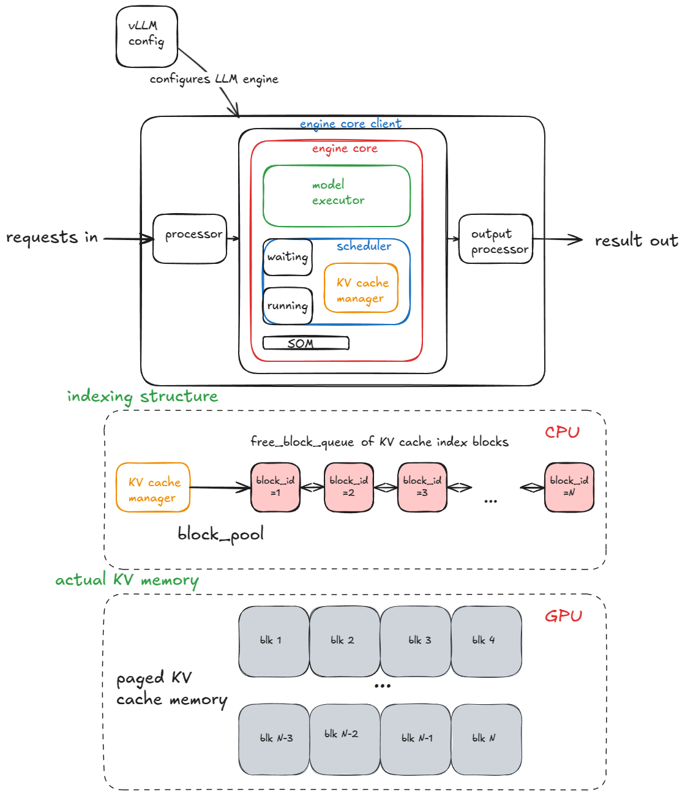
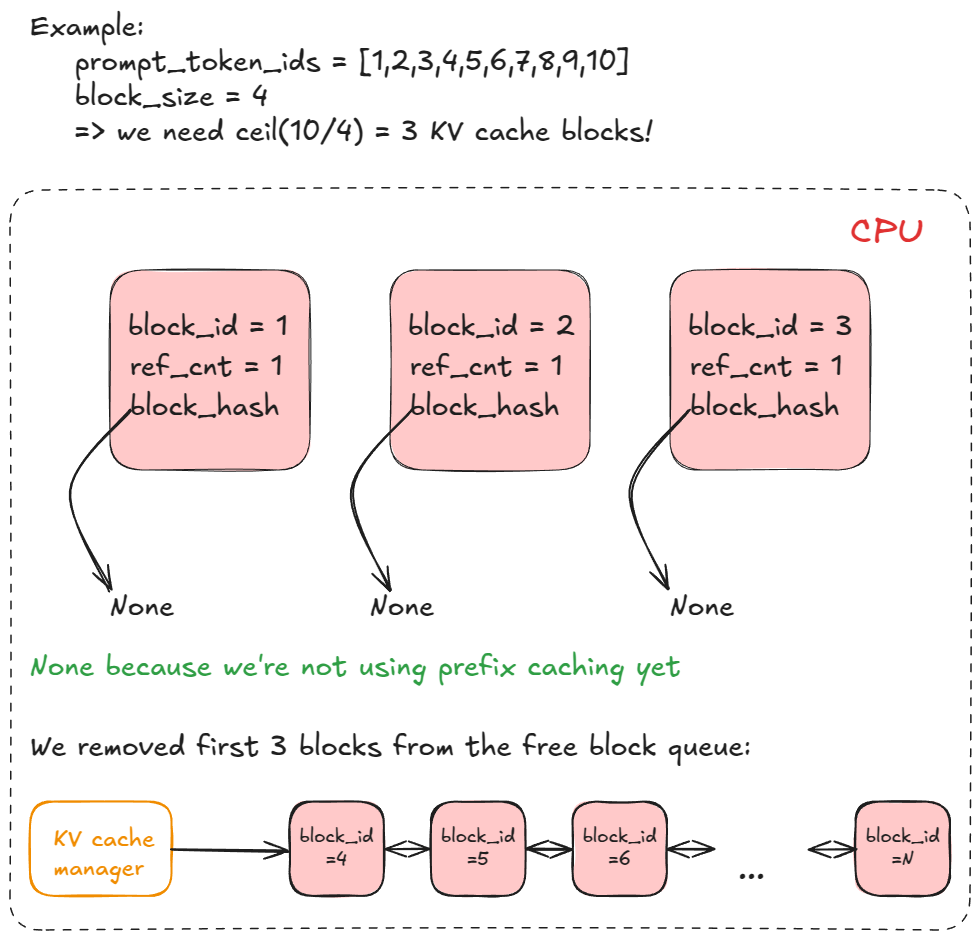
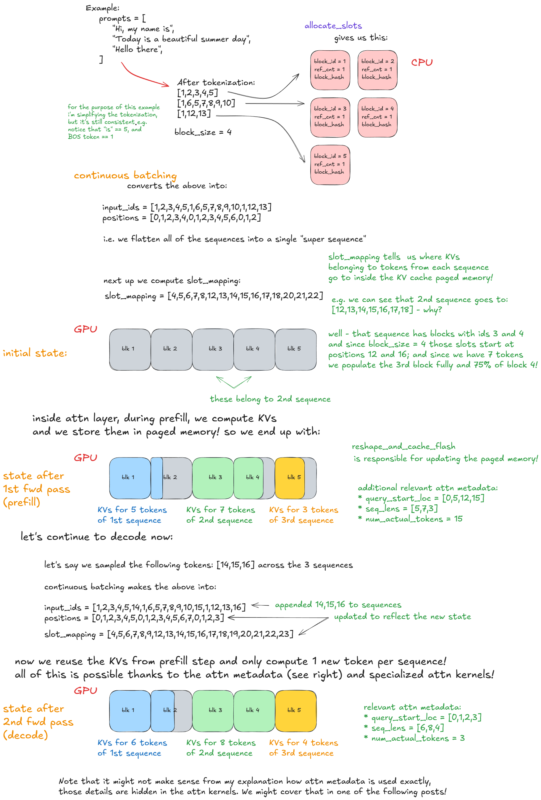
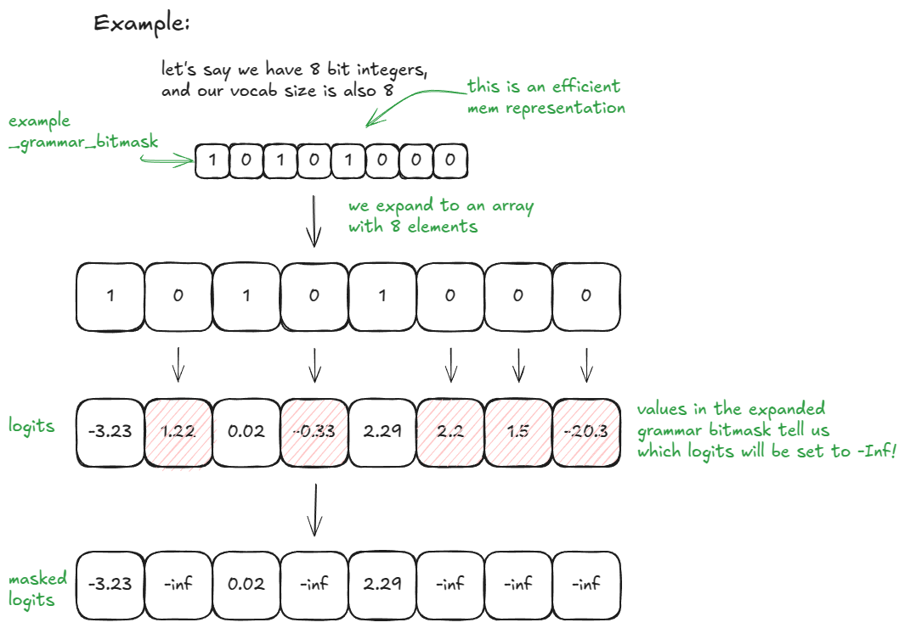
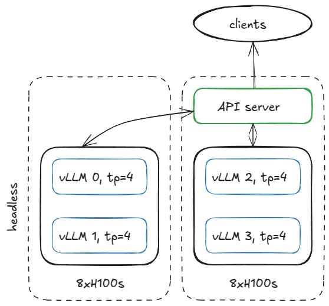
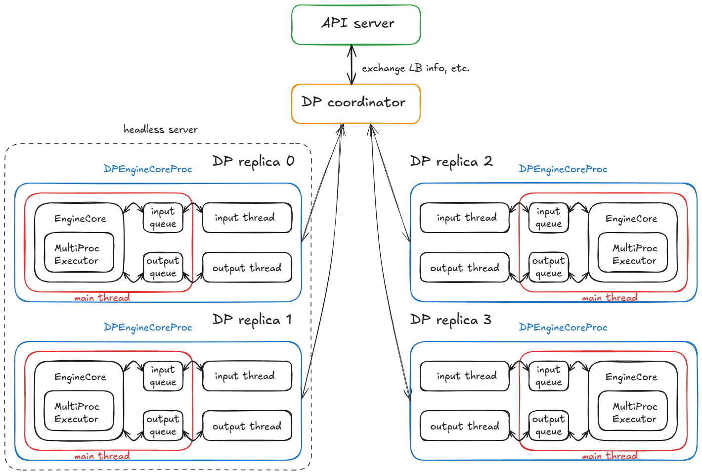
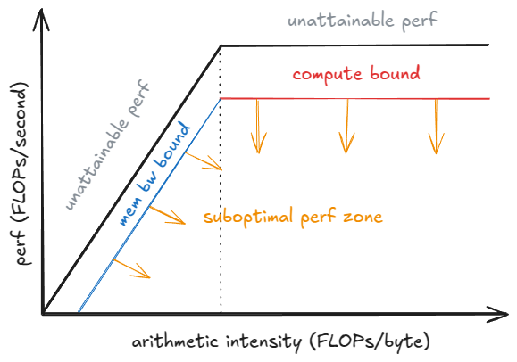

# Inside vLLM: Anatomy of a High-Throughput LLM Inference System

> 참고: [vLLM 공식 블로그 - Anatomy of vLLM](https://vllm.ai/blog/2025-09-05-anatomy-of-vllm)

## LLM Engine & Engine Core

```python
from vllm import LLM, SamplingParams

prompts = [
    "Hello, my name is",
    "The president of the United States is",
]

sampling_params = SamplingParams(temperature=0.8, top_p=0.95)

def main():
    llm = LLM(model="TinyLlama/TinyLlama-1.1B-Chat-v1.0")

    outputs = llm.generate(prompts, sampling_params)

if __name__ == "__main__":
    main()
```

이 코드의 특징:
- offline
- 동기식
- 단일 GPU 사용 (데이터/모델/파이프라인/전문가 수준의 병렬 처리가 없음; DP/TP/PP/EP = 1)
- 표준 트랜스포머 사용

### LLM Engine constructor

구성 요소
- vLLM Config: 모델 캐시, 병렬 처리 등 옵션
- processor: 원시 데이터 검증, 토큰화 및 처리를 거쳐 EngineCoreRequests 형태로 변환
- engine core client
- output processor

Engine core 구성 요소
- Model Executor
- Structured Output Manager
- Scheduler: 다음 엔진 단계로 어떤 요청을 보낼지 결정
  - policy setting: FCFS or priority
  - waiting / running queue
  - KV cache manager: paged attention 핵심
    - free_block_queue 구조 유지 = 사용 가능한 KV-캐시 블록들의 집합



모델 실행자 생성 시 Worker 객체가 생성되며, 아래 절차가 실행됩니다.

1. 장치 초기화: 워커에 CUDA 디바이스 할당, 모델의 데이터 타입이 지원되는지 확인 (bf16)
   - 요청된 gpu_memory_utilization에 필요한 만큼의 VRAM이 충분히 확보되어 있는지 확인
   - 분산 설정 구성 (DP/TP/PP/EP)
   - model_runner 인스턴스화 (샘플러, KV cache, input_ids, positions 등)
   - InputBatch 객체 생성
2. 모델 로드
   - 모델 아키텍처 구현
   - 모델 가중치 로드
   - 모델.eval() = PyTorch의 추론 모드
   - 선택 사항: 모델에 torch.compile() 함수 호출
3. KV 캐시 초기화
   - 각 레이어별 KV 캐시 사양 확인
   - 가상/프로파일링 실행, GPU 메모리 스냅샷을 캡처하여 사용 가능한 VRAM에 들어갈 수 있는 KV 캐시 블록의 수 계산
   - 어텐션 레이어에 KV 캐시 텐서 할당, 형태 재조정 후 연결
   - forward pass 중 사용될 커널에 미리 attention metadata 준비

### Generate function

요청을 검증하고 엔진에 입력합니다. 각 프롬프트마다 아래 과정을 수행합니다.

1. 고유한 요청 ID 생성, 해당 요청이 도착한 시간 기록
2. 프롬프트 토큰화, prompt/prompt_token_ids/type을 포함하는 딕셔너리를 반환하는 입력 전처리 함수 호출
3. EngineCoreRequest 형식으로 구성 — 우선순위, 샘플링 파라미터, 기타 메타데이터 추가
4. 요청을 엔진 코어로 전달 → Request 객체로 감싸고 상태를 WAITING으로 설정, 이 요청을 스케줄러의 waiting 큐에 추가

이후 `step()` 함수가 호출되며 다음 순서로 진행됩니다.
- Schedule
- Forward pass: 모델을 실행해서 토큰을 샘플링
- Postprocess: 각 Request에 샘플링된 토큰 ID 추가, 종료 조건 확인, 요청이 완료되면 데이터 정리

### Scheduler

인퍼런스 엔진이 처리하는 작업 유형은 다음 두 가지입니다.

- **Prefill**: 모든 프롬프트 토큰들에 대한 정보를 미리 전달 → compute-bound 작업. 최종 토큰이 위치할 확률 분포에서 하나의 토큰을 무작위로 선택
  - **질문을 처음 한 번 읽는다** → 프롬프트 토큰을 GPU가 병렬로 계산한다 → compute-bound
- **Decode**: 가장 최근에 수신된 토큰만 처리, 이전에 수신된 토큰들은 이미 캐싱되어 있음
  - 모든 LLM 모델의 가중치와 캐시된 데이터를 로드 → 이 과정은 메모리 대역폭에 의해 제한됨
  - 다음 토큰을 생성 → 이미 프롬프트에 대한 key/value 정보는 KV Cache에 저장되어 있으므로 새로 생성된 토큰만 계산하면 됨
    - 토큰 하나를 계산하기 위해서도 모델의 weight를 메모리에서 읽어야 함 → Memory-bandwidth-bound

스케줄러는 디코딩 요청들을 우선적으로 처리합니다 (running 큐에 이미 저장된 요청들).

스케줄러가 수행하는 작업:
- 생성될 새로운 토큰의 수를 계산
- KV-Cache manager의 allocate_slots 함수 호출
- 위에서 결정된 토큰 수를 빼서 토큰 예산 업데이트
- 이후 waiting 큐에서 들어오는 대기 요청 처리
  - 계산된 블록의 수를 반환
  - KV-캐시 관리자의 allocate_slots 함수 호출
  - 대기 중이던 요청을 실행 상태로 전환, 상태를 RUNNING으로 설정
  - 토큰 예산 업데이트

**allocate_slots**는 다음을 수행합니다.
- 얼마나 많은 새로운 KV-cache 블록이 필요할지 결정 (기본적으로 블록은 16개의 토큰을 저장)
- 가용성 확인 — 풀에 충분한 블록이 없으면 종료
- 블록 할당 — KV 캐시 관리자의 코디네이터를 통해 n개의 블록을 가져와 req_to_blocks에 저장



### Run forward pass

`execute_model`을 호출하며, 주요 단계는 다음과 같습니다.

1. **Update states**: input_batch에서 처리가 완료된 요청들은 삭제, 페이지형 KV 캐시 메모리에 인덱싱하는 데 사용될 요청당 KV 캐시 블록 수 같은 메타데이터 업데이트
2. **Prepare inputs**: CPU에서 GPU로 버퍼를 복사, 위치 정보 계산, slot_mapping 구성
3. **Forward pass**: 어텐션 커널을 이용해 모델 실행
4. **Last-token states 수집**: 각 시퀀스의 마지막 위치에 해당하는 은닉 상태를 추출, logits 계산
5. **Sample**: 샘플링 구성



## Advanced Features

### Chunked prefill

긴 입력을 처리하기 위한 기술로, 입력 내용을 여러 작은 부분으로 나누어 처리합니다.

긴 프롬프트를 한 번에 prefill하면 다른 요청의 decode가 기다리게 됩니다. 청크로 나눠 처리하면 디코딩이 느려지지 않도록 할 수 있습니다.

```
시간 →

A Decode    ●
B Prefill     ████

A Decode          ●
B Prefill           ████

A Decode                ●
B Prefill                 ████

A Decode                      ●
B Prefill                       ████
```

`long_prefill_token_threshold`로 임계값을 지정합니다.

### Prefix Caching

```python
from vllm import LLM, SamplingParams

long_prefix = "<a piece of text that is encoded into more than block_size tokens>"

prompts = [
    "Hello, my name is",
    "The president of the United States is",
]

sampling_params = SamplingParams(temperature=0.8, top_p=0.95)

def main():
    llm = LLM(model="TinyLlama/TinyLlama-1.1B-Chat-v1.0")

    outputs = llm.generate(long_prefix + prompts[0], sampling_params)
    outputs = llm.generate(long_prefix + prompts[1], sampling_params)

if __name__ == "__main__":
    main()
```

Prefix caching을 사용하면 여러 프롬프트의 시작 부분에 공통으로 나타나는 토큰을 재계산하지 않습니다. 해당 토큰들은 단 한 번만 계산되고 KV 캐시에 저장되어, 이후 요청의 prefill 속도가 향상됩니다.

**vLLM에서 어떻게 작동하는가?**

`hash_request_tokens`가 호출됩니다.
- `long_prefix + prompts[0]`을 16개의 토큰 단위로 나눕니다
- 각 블록에 대해 해당 블록의 해시가 계산됩니다
- 각 결과는 블록 해시 객체로 저장됩니다
- `self.req_to_block_hashes[request_id]`에 저장됩니다

다음 호출에서 엔진은 `find_longest_cache_hit`을 통해 `cached_block_hash_to_block`에 저장된 캐시와 일치하는지 확인합니다.

### Guided Decoding (FSM)

가이드 디코딩: 각 디코딩 단계에서 문법 기반의 유한 상태 머신(FSM)에 의해 logit이 제약되는 기술입니다. 문법에 의해 허용되는 토큰만 샘플링하도록 하여, LLM이 출력을 생성할 때 특정 형식(JSON, regex, CFG 등)을 **반드시 따르도록 강제**합니다. 현재 단계에서 어떤 토큰이 올 수 있는지를 상태 머신으로 정의해 활용합니다.

작동 원리:
- LLM engine 구축 시 `StructuredOutputManager`가 생성되며, 토크나이저에 접근할 수 있습니다
- 요청을 추가할 때 상태는 `WAITING_FOR_FSM`으로 설정됩니다
- 스케줄링 과정에서 비동기 컴파일이 완료되면 상태가 WAITING으로 변경됩니다
- 스케줄링 루프가 완료된 이후 FSM 요청이 있다면 `grammar_bitmask`를 준비합니다
- 포워드 패스를 통해 logit 값이 생성되면 `xgr_torch_compile` 함수가 비트마스크를 어휘 크기만큼 확장하고, 허용되지 않은 값들은 `-무한대`로 설정합니다
- 다음 토큰을 샘플링하고, 해당 요청의 FSM은 `accept_tokens`를 통해 다음 상태로 이동합니다



### Speculative Decoding

자기회귀적 생성 방식에서는 새로운 토큰 생성을 위해 대규모 언어 모델을 반복 실행해야 하므로 비효율적입니다. Speculative Decoding(추측 기반 디코딩)은 더 작은 규모의 언어 모델을 사용해 속도를 높이는 기법으로, k개의 토큰을 저렴한 비용으로 생성(후보 예측)하고 무엇이 유효한지는 큰 규모의 언어 모델이 결정합니다.

절차:
- **Draft**: 소형 모델을 실행해 k개의 토큰을 제안
- **Verify**: 큰 모델을 컨텍스트와 k개의 초안 토큰으로 한 번 실행 → k개 위치에 대한 확률을 얻음 (k+1개 후보)
- **Accept/reject**: 왼쪽부터 오른쪽으로 k개의 토큰을 평가
  - 큰 모델의 확률이 draft보다 높으면 채택
  - 그렇지 않으면 `p_large(token)/p_draft(token)` 확률로 수락
  - 첫 번째 reject에서 중단
    - 모든 k개의 초안 토큰이 승인되면, 대규모 모델에서 추가로 k+1번째 토큰도 샘플링 → 이미 큰 모델이 검증하면서 "덤으로" 계산되는 다음 토큰
    - 만약 거부되면, 해당 위치에서 새로 재조정된 분포를 생성 (큰 모델이 직접 토큰 선택)
  - 최악의 경우에도 결과는 큰 모델 단독 실행과 동일합니다 (모든 토큰이 거부되는 경우)

이 방식이 효율적인 이유는, 생성은 "다음 단어를 몰라서 기다려야 하는" 작업인 반면 검증은 "단어가 이미 다 있으니 한 번에 처리"할 수 있는 작업이기 때문입니다. 그래서 k개를 검증하는 비용이 큰 모델 1회 실행 비용과 같아집니다.

vLLM이 지원하는 방식:
- **n-gram**: 마지막 `prompt_lookup_max`개의 토큰을 가져와 해당 시퀀스 내에서 이전에 일치하는 부분을 찾습니다. 일치하는 부분이 발견되면 그 뒤에 오는 k개의 토큰을 제안하고, 아니면 다시 시도합니다
- **Eagle**: 대규모 LM에 model surgery를 수행 — 임베딩 및 LM 헤드는 유지하고, 트랜스포머 스택을 경량 MLP로 대체해 저렴한 프로토타입으로 미세 조정
- **Medusa**: 큰 모델의 LM 헤드 이전 단계에 선형 헤드를 추가해 병렬적으로 다음 k개의 토큰을 예측

### Disaggregated P/D

Prefill과 decoding은 매우 다른 성능 특성을 가지므로, 각각의 실행을 분리하는 것이 합리적인 설계입니다.

실제로는 N개의 vLLM prefill instance와 M개의 vLLM decoding instance를 운영하며, 실시간 요청 혼합에 따라 자동으로 확장합니다.

절차:
- **Instantiation**: 워커 내부의 워커 초기화, 스케줄러 내부의 스케줄러 초기화
- **Cache lookup**: 스케줄러가 waiting 큐에서 prefill 요청을 처리할 때, KV-캐시 서버에 저장된 캐시된 토큰을 확인
- **State update**: 스케줄러는 캐시가 있는 요청을 기록
- **Build metadata object**: 스케줄링이 끝나면 호출됨
  - Prefill은 모든 요청에 KV 업로드용 (`is_store=True`) 추가
  - Decoding은 KV를 가져오기 위해 (`is_store=False`) 추가
- **Context manager**: forward pass 전에 엔진은 KV-connector context manager에 진입
  - 입장 시: `kv_connector.start_load_kv` 호출
  - 종료 시: `wait_for_save` 호출

## From UniprocExecutor to MultiProcExecutor

만약 모델 weight가 단일 GPU의 VRAM에 들어가지 않는다면 어떻게 해야 할까요?

**1. TP 옵션**

같은 노드 내 여러 GPU에 텐서 병렬성을 사용해 모델을 샤딩합니다.

> **Notes**
> - 노드 내 대역폭은 노드 간보다 훨씬 높기 때문에, 일반적으로 TP(텐서 병렬성)가 PP(파이프라인 병렬성)보다 선호됩니다
> - DP: 데이터를 나눔 (모델은 복사)
> - TP: 행렬 연산을 나눔 (레이어 내부를 쪼갬)
> - PP: 레이어를 나눔 (레이어 자체를 분할)

여러 개의 GPU 프로세스를 오케스트레이션하는 레이어가 필요하며, `MultiProcExecutor`가 이 기능을 제공합니다.

**작동 원리**
- `MultiProcExecutor`는 `rpc_broadcast_mq` 메시지 큐를 초기화합니다
- 각 워커마다 부모 프로세스는 reader/writer pipe를 생성합니다
- 새로운 프로세스는 `WorkerProc.worker_main`에서 실행되며, `UniProcExecutor`와 동일한 초기화/모델 로드 등의 과정을 거칩니다
- 각 워커는 driver(TP 그룹의 0번 rank)인지 일반 워커인지 결정하고, `rpc_broadcast_mq`와 `worker_response_mq` 대기열을 사용합니다
- 초기화가 끝나면 자신의 `worker_response_mq` 핸들을 부모 프로세스에 보내고, 모든 핸들이 수신되면 부모 프로세스가 실행됩니다
- 워커는 busy loop에 진입해 work item이 오면 실행하며(`UniProcExecutor`와 동일한 방식), 결과는 `worker_response_mq`에 반환합니다
- `MultiProcExecutor`는 모든 자식 프로세스에 `rpc_broadcast_mq` 방식으로 작업을 큐에 넣고, 지정된 출력 채널의 `worker_response_mq.dequeue`에서 결과를 수집합니다

엔진 관점에서는 변화가 없으며, 모든 멀티프로세싱 복잡성은 모델 실행자의 `execute_model` 호출을 통해 추상화됩니다.

## Distributed system serving vLLM

예: 두 개의 H100 노드를 가지고 있으며, 두 노드에서 4개의 vLLM 엔진을 실행하고 싶다고 가정합니다.

TP=4가 필요하다면 아래와 같이 구성합니다.



```
vllm serve <model-name>
  --tensor-parallel-size 4
  --data-parallel-size 4
  --data-parallel-size-local 2
  --data-parallel-start-rank 0
  --data-parallel-address <master-ip>
  --data-parallel-rpc-port 13345
  --headless
```



## Benchmarks and auto-tuning — latency vs throughput

두 가지 핵심 지표가 있습니다.
- **Latency**: 요청이 제출된 시점부터 토큰이 반환될 때까지의 시간
- **Throughput**: 시스템이 초당 생성/처리할 수 있는 토큰/요청의 수

| Metric (단위) | Definition (정의) |
| --- | --- |
| `TTFT` (time to first token) | 요청 제출 시점부터 첫 번째 출력 토큰을 받은 시점까지의 시간 |
| `ITL` (inter-token latency) | 두 개의 연속된 토큰 사이의 시간 (예: 토큰 i-1에서 토큰 i까지) |
| `TPOT` (time per output token) | 요청에서 생성된 모든 토큰에 대한 평균 ITL |
| `Latency / E2E` (end-to-end latency) | 요청 처리에 소요되는 총 시간, 즉 TTFT + 모든 ITL 값의 합. 또는 요청 제출 시점부터 최종 출력 토큰 수령 시점까지의 시간 |
| `Throughput` | 초당 처리되는 총 토큰 수 (입력, 출력 또는 둘 다), 또는 초당 요청 수 |
| `Goodput` | 서비스 수준 목표(SLO)를 충족하는 처리량. 예를 들어 최대 TTFT, TPOT, 또는 종단 간 지연 시간 등의 조건이 충족되는 경우에만 카운트됩니다 |



### How to benchmark in vLLM

`vllm bench` CLI가 제공되며, server/latency/throughput 세 가지 벤치마크를 지원합니다.

제공되는 정보:
- **Latency**: 32 input, 128 output token 기준
- **Throughput**: 미리 정의된 프롬프트 세트를 한 번에 제출 → 입력/출력/총 토큰 수, 초당 요청 수 측정
- **Serve**: vLLM 서버를 실행하고, Poisson 분포에서 요청 도착 시간을 샘플링해 실제 워크로드를 시뮬레이션

```
vllm bench latency
  --model <model-name>
  --input-tokens 32
  --output-tokens 128
  --batch-size 8
```
