# 3. Linear Regression I

[강의 영상](https://www.youtube.com/watch?v=n7btozy6pWE&list=PL0E_1UqNACXCpyohL0_uMNaqr0QuXOMBi&index=3)

### Linear Regression
Linear regression은 가장 단순한 지도학습(supervised learning) 접근이다. 입력 $x_1, x_2, \dots, x_p$와 출력 $y$의 관계가 **선형**이라고 가정한다.

- 선형이라는 것은 기울기가 일정하다는 뜻이다. 입력 $x_i$가 2배가 되면 $y$에 주는 영향도 2배, 절반이 되면 영향도 절반이 된다.
- 현실의 문제는 대부분 정확히 선형이 아니다. 그래도 가장 쉬운 방법이고, 비선형 방법들도 결국 여기서 출발하기 때문에 먼저 알아둬야 한다.

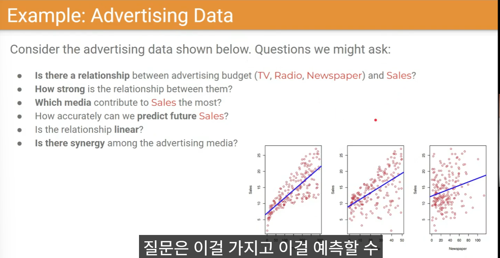

광고 데이터(TV, Radio, Newspaper 광고비 → Sales)로 던질 수 있는 질문들:

1. 일단 input과 output 사이에 관계가 있는가?
	- 가장 먼저 던져야 할 질문이다. 랜덤하게 만든 $x$, $y$에 선형 회귀를 돌려도 아무것도 찾을 수 없다. 기울기가 음수인 것도 관계가 있는 것이다.
2. 관계가 얼마나 강하게 나타나는가?
3. 그래서 Sales에 가장 영향을 주는 매체는? (같은 비용이면 어디에 투자해야 효과가 큰가)
4. 과거의 패턴이 미래 예측에 도움이 되는가? (패턴이 유지되는지, 시간에 따라 바뀌는지)
5. 관계가 선형적인가? (예산을 2배 쓰면 효과도 2배인지, 더 커지는지, 포화되는지)
6. 매체들 사이에 상관관계가 있는가? (synergy)
	- 세 매체가 서로 무관하다면 가장 효과적인 하나에 올인하는 것이 최선이다.
	- 서로 영향을 준다면(TV에서 본 광고를 신문에서 다시 보는 경우 등) 나눠서 투자하는 편이 나을 수 있다. 시너지는 마이너스일 수도 있다. → 다음 시간에 다룸

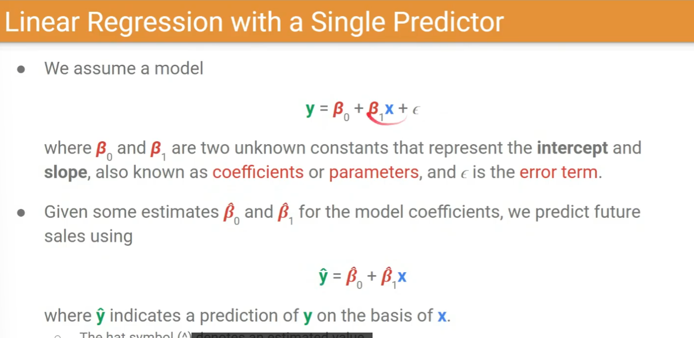

가장 간단한 모델, predictor(입력)가 하나인 경우를 가정해보자. 중학교 때 배운 1차 함수 $y = ax + b$와 같은 꼴이다.

- $\beta_0$: 절편(intercept). 광고를 하나도 안 했을 때의 기본 매출
- $\beta_1$: 기울기(slope). 광고비를 늘렸을 때 매출이 얼마나 비례해서 오르내리는지. 아무 관계가 없다면 0이 나와야 한다.
- 둘을 합쳐 coefficients(계수) 또는 parameters라고 부른다.
- 진짜 $\beta_0, \beta_1$은 "신만이 아는 값"이다. 데이터로부터 추정한 값에는 hat을 붙여 $\hat\beta_0, \hat\beta_1$로 쓰고, 이것으로 계산한 예측값이 $\hat y$다.

모델이 얼마나 잘 예측했는지 어떻게 평가할까?

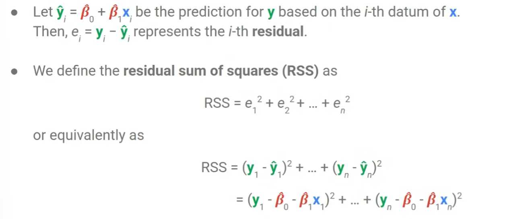

- $i$번째 데이터의 실제값 $y_i$와 예측값 $\hat y_i$의 차이 $e_i = y_i - \hat y_i$를 residual(잔차)이라 한다.
- 지금은 플러스로 틀리든 마이너스로 틀리든 상관없이 정확히 맞추는 것이 중요하다고 보고, 잔차를 제곱한다.
- RSS(Residual Sum of Squares) = 잔차 제곱의 총합. 제곱의 합이라 0보다 작을 수 없고, 0이면 모든 점을 완벽하게 맞춘 것이다.

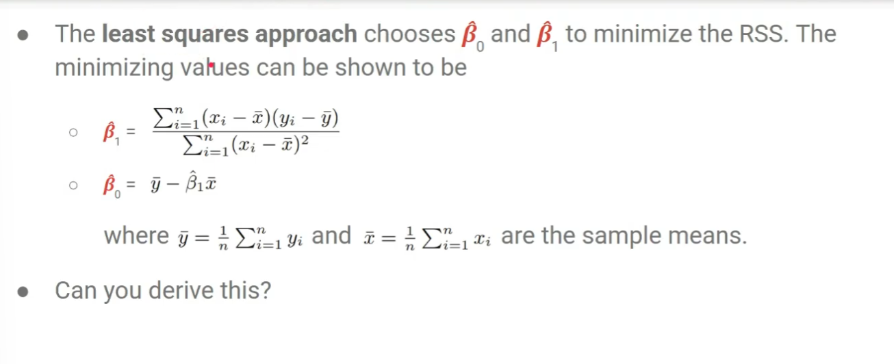
최소제곱법(least squares method): RSS를 최소화하는 $\hat\beta_0, \hat\beta_1$을 찾는다. 오차를 제곱(square)해서 더하고, 그것을 최소화(least)하기 때문에 붙은 이름이다. $\bar x, \bar y$는 표본 평균이다.

직접 미분해서 유도해보기:
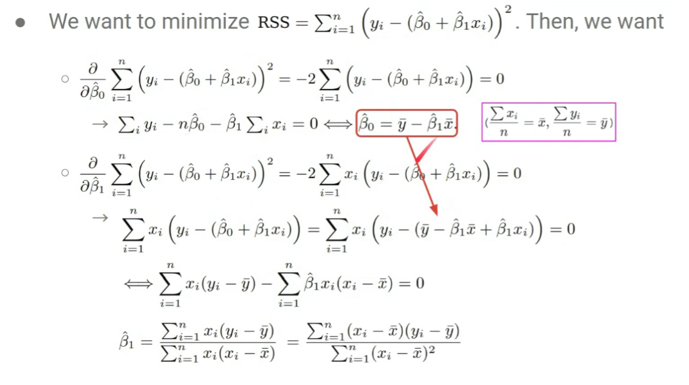

- RSS를 $\hat\beta_0$, $\hat\beta_1$로 각각 편미분해서 0으로 놓고 풀면 극값이 나온다.
- $\hat\beta_0$로 미분: 시그마를 풀면 $\sum y_i - n\hat\beta_0 - \hat\beta_1\sum x_i = 0$ → 양변을 $n$으로 나누면 $\hat\beta_0 = \bar y - \hat\beta_1 \bar x$
- $\hat\beta_1$로 미분: 이번엔 $x_i$가 하나 더 붙는다. 위에서 구한 $\hat\beta_0$를 대입하고 $\hat\beta_1$이 있는 항과 없는 항으로 묶으면 $\hat\beta_1 = \frac{\sum x_i(y_i - \bar y)}{\sum x_i(x_i - \bar x)}$
- 이것이 슬라이드의 $\frac{\sum (x_i - \bar x)(y_i - \bar y)}{\sum (x_i - \bar x)^2}$와 같다는 것을 보이려면 트릭이 필요하다. $\sum \bar x (y_i - \bar y) = \bar x(\sum y_i - n\bar y) = 0$, $\sum \bar x(x_i - \bar x) = 0$이므로 분자·분모의 $x_i$를 $(x_i - \bar x)$로 바꿔도 값이 같다.
- 핵심: $\hat\beta_0, \hat\beta_1$이 데이터 $x, y$만으로 이루어진 식으로 표현된다. 데이터로부터 파라미터를 계산해내는 것, 이게 data-driven AI다.

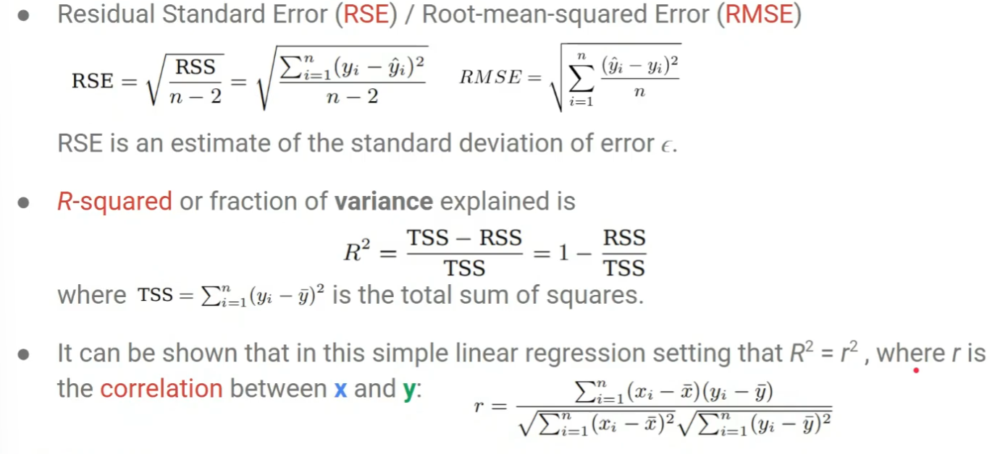
모델 평가 지표

- **RSE(Residual Standard Error)** $= \sqrt{\frac{RSS}{n-2}}$: 데이터 하나당 평균적으로 얼마나 틀렸는지. 오차 $\epsilon$의 표준편차 추정값이다.
- 통계에서는 $n-2$로 나눠야 bias가 없어진다고 하지만, 빅데이터에서는 표본이 수억 개라 2를 빼든 말든 차이가 없다. 그래서 실용적으로는 그냥 $n$으로 나누는 **RMSE(Root Mean Squared Error)**를 많이 쓴다.
- **R-squared**(fraction of variance explained) $= \frac{TSS - RSS}{TSS} = 1 - \frac{RSS}{TSS}$
	- TSS는 데이터 자체의 분산(편차 제곱의 합), RSS는 그중 모델이 틀려서 남은 부분이다.
	- 모델이 완벽하면 RSS = 0 → $R^2 = 1$, 완전히 틀리면 RSS = TSS → $R^2 = 0$.
	- 0과 1 사이 값이고, 1에 가까울수록 모델이 잘 맞춘 것이다.
- 단순 선형 회귀에서는 $R^2 = r^2$이다. $r$은 $x$와 $y$의 상관계수(correlation)다.

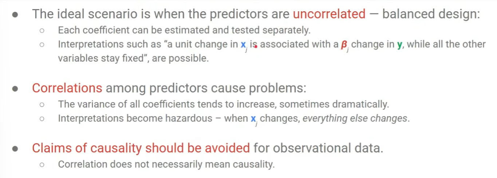

- 선형 회귀의 이상적인 상황은 predictor끼리 상관관계가 없는(uncorrelated) 것이다. 그래야 "$x_j$가 1 변하면, 다른 변수가 고정일 때 $y$가 $\beta_j$만큼 변한다"고 해석할 수 있다.
- 실제로는 predictor 사이에 상관관계가 있는 경우가 많다. 예: TV 광고를 이미 많이 한 상태에서 신문 광고를 하는 것과 TV 광고 없이 신문 광고를 하는 것은 효과가 다를 수 있다. 이때는 계수의 분산이 커지고, $x_j$가 변하면 다른 것도 같이 변해서 해석이 위험해진다. → 다음 시간에 다룸

상관관계는 인과관계와 다르다

- 관찰 데이터로 인과를 주장하면 안 된다.
- 예: 교회가 많은 도시는 범죄율이 높다. 교회 때문이 아니라 사이에 다른 변수(인구)가 있다. 교회가 많은 곳은 인구가 많은 대도시이고, (미국에서) 대도시는 범죄율이 높다.

선형 회귀로 구한 계수($\beta$)가 크다고 그 변수가 더 중요하다고(영향이 크다고) 할 수 없다!

- 광고 예시에서 Radio의 계수가 TV보다 크게 나왔지만, 실제 Sales와의 상관관계는 TV 쪽이 더 높았다.
- Coefficient 값에는 input 값의 스케일도 반영된다.
	- 예: 기후 모델에서 기온은 -30 ~ 40 범위, 기압은 1000 hPa 근처 값이다. 기압 앞의 계수는 큰 값을 상쇄하려고 작게, 기온 앞의 계수는 크게 붙는다.
- 스케일 차이가 반영되어 있으니 계수의 단순 대소로 중요도를 비교하면 안 된다.
- 광고 데이터를 보면 Radio와 Newspaper 사이에 무시하기 힘든 상관관계(시너지)도 보인다. → 다음 시간에 다룸

### Maximum Likelihood
왜 최소 제곱을 하는가? 예측 $\hat y$와 정답 $y$를 비슷하게 만드는 방법(지도학습 4단계 중 2단계: 목표 정의)은 절댓값, 비율 등 여러 가지가 있다. 왜 하필 최소 제곱일까?

IID Assumption = Independent and Identically Distributed
- Independent(독립): 데이터들이 서로 영향을 주지 않는다. 하나를 관측해도 다른 결과를 예측하는 데 아무 정보를 주지 않는다.
	- 예: 이번 주 로또 번호를 알아도 다음 주 번호를 맞힐 확률은 오르지 않는다. 지금까지 25번이 가장 많이 나왔다고 25번을 찍는 게 유리하지 않다.
- Identically distributed: 모든 데이터가 같은 확률 분포에서 샘플링된다.
- 대표 예: 같은 주사위를 100번 던지는 것. 주사위가 완벽한 정육면체가 아니어서 각 눈이 정확히 1/6이 아니어도 분포 자체는 매번 같고, 각 시행은 독립이다.
- 실제로 수집하는 데이터는 대부분 IID가 완벽하게 맞지 않는다. 예: 광고 데이터는 오랜 기간 수집되는 동안 경기 변화, 경쟁사 등장 같은 일이 생긴다.

IID는 명백히 아니라는 증거가 없으면 그냥 충족한다고 가정한다!

**Likelihood**
$n$개의 데이터를 가지고 있을 때, i.i.d. 가정 하에서 어떤 분포가 존재하고 우리가 거기서 샘플링해서 뽑은 데이터라고 본다.
-> 같은 분포에서 $n$번 뽑은 것
Likelihood: 그 분포에서 지금 가진 데이터가 관측될 확률
- 예: 앞면 확률 2/3, 뒷면 확률 1/3인 동전을 세 번 던져 앞·앞·뒤가 나왔다면, 그 데이터를 얻을 확률은 $\frac23 \times \frac23 \times \frac13$이다.
- 독립이니까 각각의 확률을 곱할 수 있고, 같은 분포니까 같은 $p_\theta$의 곱 $\prod p_\theta(x_i)$로 쓸 수 있다.
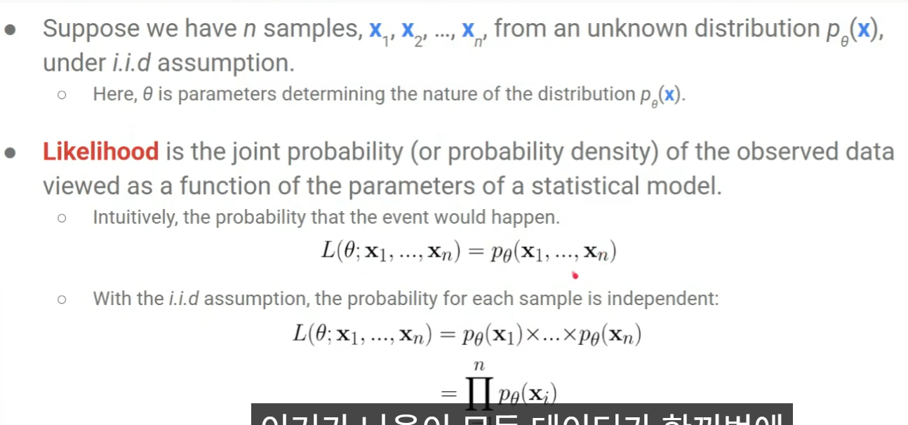

Likelihood: 내가 가지고 있는 데이터 전체에 대한 확률

Log-Likelihood: likelihood 앞에 로그를 붙인 것
- 로그를 붙이면 곱이 합으로 바뀌어 미분하기 편하다.
- 로그 함수는 단조 증가(monotonically increasing)하므로, likelihood를 최대로 만드는 값과 log-likelihood를 최대로 만드는 값이 같다.
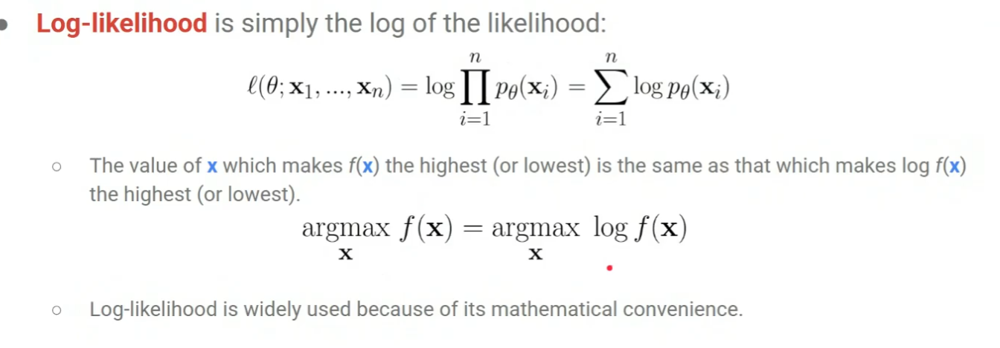

**Maximum Likelihood Estimator**
우리는 확률 분포의 정확한 파라미터를 모른다. 분포의 식만 알고 파라미터 $\theta$는 미지수다. (예: 동전이면 앞면 확률 $\theta$, 뒷면 확률 $1-\theta$라는 형태만 안다)
-> 가정한 확률 분포를 기준으로, 실제 관측한 데이터가 가장 그럴듯하게 나오도록 하는 $\theta$를 역으로 찾는 것이 MLE다.

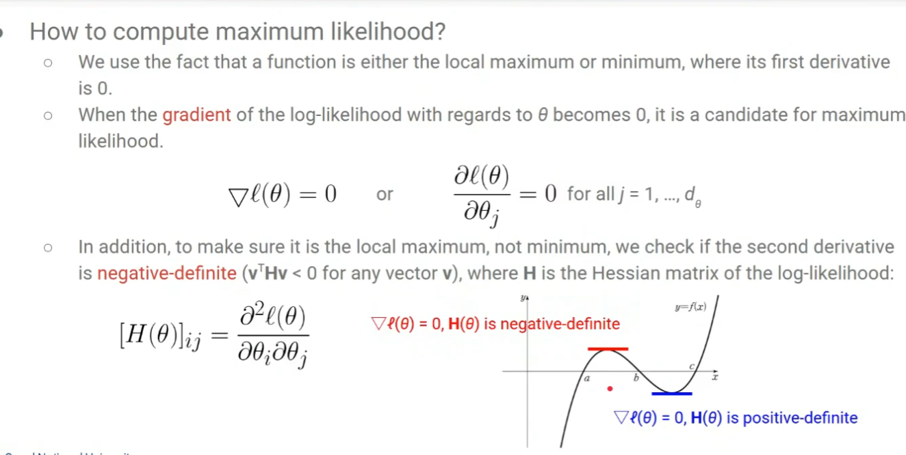

미분해서 찾기:
- log-likelihood의 gradient가 0이 되는 점이 최대값 후보다.
- 1차 미분이 0인 점은 극대일 수도, 극소일 수도 있다. 그래서 두 번 미분해서 확인한다. 극대에서는 2차 미분이 음수, 극소에서는 양수다.
- 행렬(Hessian)로 일반화하면: 어떤 벡터 $v$를 앞뒤로 곱해도 $v^\top H v < 0$이면 negative-definite → 극대, 항상 양수면 positive-definite → 극소.

MLE 예시 1: Bernoulli 분포(동전 던지기)
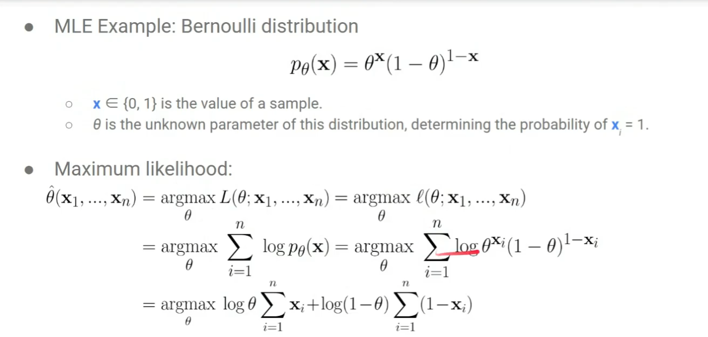
로그를 풀어서 정리한다.

이게 최대가 되는 값을 찾는다 -> $\theta$에 대해서 미분하기
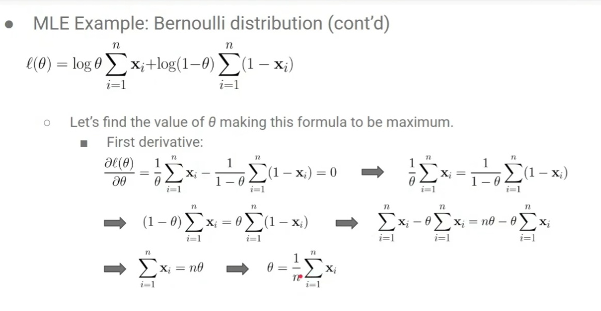
대박 신기
-> $\theta = \frac1n \sum x_i$, 즉 앞면이 나온 비율이 나온다. 100번 중 60번 앞면이 나왔다면 $\theta = 0.6$인 동전이라고 추론하는 것이 가장 그럴듯하다.
- 한 번 더 미분하면 $-\frac{\sum x_i}{\theta^2} - \frac{\sum(1-x_i)}{(1-\theta)^2}$로 항상 음수다. 따라서 극대가 맞다.

MLE 예시 2: 정규 분포
- 파라미터 $\theta$는 평균 $\mu$와 분산 $\sigma^2$이다. 같은 방식으로 log-likelihood를 각각 미분해서 0으로 놓는다.
- $\mu$로 미분: $\hat\mu = \frac1n \sum x_i$ → 표본 평균
- $\sigma$로 미분: $\hat\sigma^2 = \frac1n \sum (x_i - \hat\mu)^2$ → 표본 분산(편차 제곱의 평균)
- 표본에서 구한 평균과 분산을 모집단의 평균과 분산이라고 추론하는 것이 가장 합리적이라는 결론이다. (2차 미분 확인은 직접 해보기)

**MLE for Linear Regression**
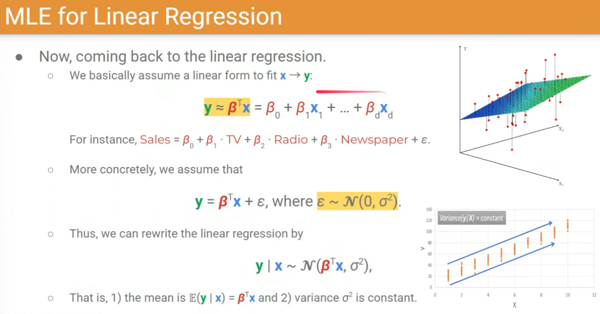

- $y = \beta^\top x + \epsilon$, $\epsilon \sim \mathcal N(0, \sigma^2)$로 본다. 즉 $y \mid x \sim \mathcal N(\beta^\top x, \sigma^2)$이다.
- 깔린 가정 두 가지:
	1. 평균은 linear한 폼을 따라간다: $\mathbb E(y \mid x) = \beta^\top x$
	2. $\sigma^2$은 constant다: 입력 $x$가 무엇이든 오차의 크기는 일정하다(± $\sigma$만큼 틀린다).
- 여기서 추정할 파라미터 $\theta$는 $\beta$다. $x$는 데이터이고 $\sigma$는 상수로 정해두었다.
- 정규 분포 식에서 데이터 자리에는 $y$가, 평균 자리에는 $\beta^\top x$가 들어간다.

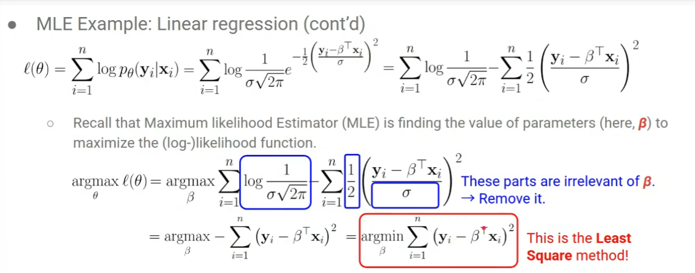
- $\beta$와 무관한 항($\log\frac{1}{\sigma\sqrt{2\pi}}$, $\frac12$, $\sigma$)은 미분하면 사라지므로 지운다.
- 마이너스를 떼면 argmax가 argmin으로 바뀐다 → $\arg\min_\beta \sum (y_i - \beta^\top x_i)^2$

결국 최소 제곱법이 나온다!
maximum likelihood 관점에서 관측 데이터를 가장 그럴듯하게 만드는 $\beta$를 찾으면 그것이 최소 제곱법이다.

즉 최소 제곱법 = MLE. 단, linear fitting + noise가 constant(정규 분포, 일정한 분산)라는 가정 하에서다.

**Linear Regression with Matrix Notation**

- 지금까지는 데이터 하나씩: $y_i$는 스칼라, $x_i$와 $\beta$는 $d$차원 벡터. 내적하면 $1\times d$와 $d\times 1$이라 스칼라가 된다.
- 행렬로 쓰면 $n$개를 한 번에 처리한다. $X$는 $n \times d$, $\beta$는 여전히 $d \times 1$ 하나, $Y$는 $n \times 1$이다.
- $(Y - X\beta)^\top (Y - X\beta)$는 $1\times n$과 $n\times1$의 곱이다. 각 잔차를 제곱해서 더한 RSS와 같다. $n = 1$이면 앞의 식과 똑같아진다.

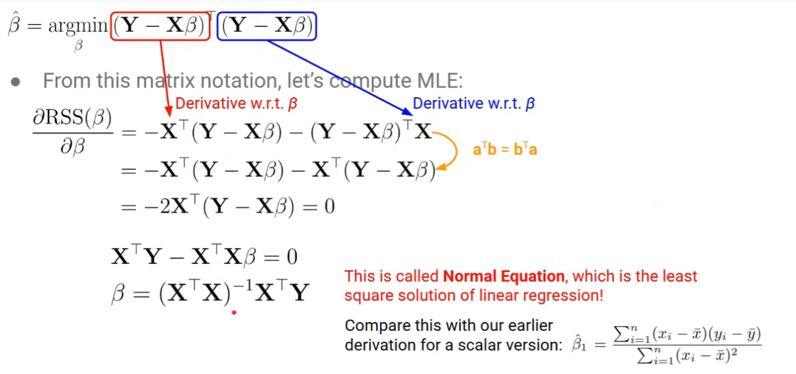

- $\beta$로 미분해서 0으로 놓으면 $\beta = (X^\top X)^{-1} X^\top Y$. 이것을 **Normal Equation**이라 하고, 선형 회귀의 최소 제곱 해다.
- 스칼라 버전 $\hat\beta_1$과 비교하면 모양이 닮았다. $x$와 $y$를 곱해 더한 것($X^\top Y$)이 분자에, $x$ 제곱($X^\top X$)이 분모(역행렬)에 있다.
- 차원 확인: $(X^\top X)^{-1}$은 $d\times d$, $X^\top$은 $d \times n$, $Y$는 $n\times1$ → $\beta$는 $d\times1$. 입력 차원마다 계수가 하나씩 붙으니 맞다.
- 예측: 새 데이터 하나는 $\hat y = \beta^\top x$(스칼라), 여러 개는 $\hat Y = X\beta$($n \times 1$, 문제 $n$개에 답 $n$개)

$\hat\beta$의 통계적 성질
- 기댓값: $\mathbb E[\hat\beta \mid X] = (X^\top X)^{-1}X^\top \mathbb E[Y \mid X] = (X^\top X)^{-1}X^\top X\beta = \beta$ → 추정값의 기댓값이 진짜 $\beta$다. 즉 bias가 없다(unbiased).
- 분산: $\mathrm{Var}(\hat\beta \mid X) = \sigma^2 (X^\top X)^{-1}$ → 데이터가 많아질수록 $X^\top X$가 커지므로 분산은 줄어든다. 데이터가 적으면 예측이 불확실하다.

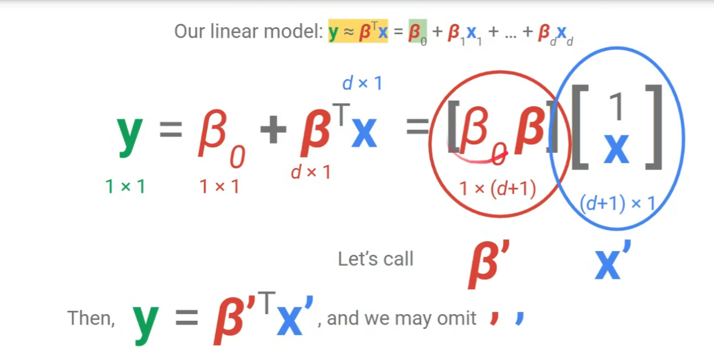

- 사실 $y = \beta_0 + \beta^\top x$처럼 절편(bias term) $\beta_0$가 있어야 하는데, 매번 쓰면 $d+1$차원이 되어 번거롭다.
- 트릭: $\beta$ 앞에 $\beta_0$를, $x$ 앞에 1을 붙인 $(d+1)$차원 벡터 $\beta'$, $x'$를 만들면 $y = \beta'^\top x'$가 된다.
- 그리고 prime을 생략해 그냥 $y = \beta^\top x$라고 쓴다. 앞으로 이렇게 쓰면 bias term이 들어 있는 것으로 생각하면 된다.

**Bias Variance Decomposition**
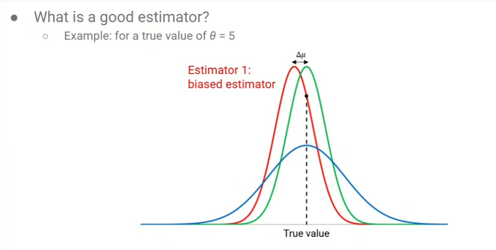
좋은 estimator는??

- 우리가 하는 일은 "신만이 아는" 분포의 파라미터 $\theta$를 데이터로부터 추정하는 것이다. MLE는 그 방법(estimator) 중 하나다.
- 좋은 estimator는 실제값을 정확히 맞힌다. 안 좋은 estimator는 두 가지 형태다.

1. biased estimator: 값이 한쪽으로 치우친다. (예: 사람들의 평균 키를 측정할 때 계속 과소평가하는 측정 방식)
2. inconsistent estimator: 평균(기댓값)은 맞지만 오차가 너무 크다. 어떨 땐 많이 틀린다.

좋은 estimator는 실제값 근처에 밀집해서 분포한다.

- 편향(Bias): 추정값의 기댓값과 실제값의 차이 $\mathbb E(\hat\theta) - \theta$. 데이터를 모으고 통계를 내는 방법 자체가 현실을 한쪽으로 치우치게 보여주는 체계적인 경향이다.
	- 예: 확률을 정해둔 동전을 100번 던져 추정하는 시뮬레이션을 여러 번 반복했을 때, 추정값들의 평균이 실제값에서 벗어나 있으면 편향이 있는 것이다.
- 분산(Variance): 추정을 여러 번 했을 때 데이터가 달라서 생기는 추정값들의 흩어짐. 추정값과 그 평균 사이 차이를 제곱한 값의 기댓값 $\mathbb E[(\hat\theta - \mathbb E(\hat\theta))^2]$이다.
- 평균제곱오차(MSE): 추정값과 실제값 차이를 제곱한 값의 평균이다.

우리가 줄이고 싶은 것은 MSE이고, 이는 variance + bias²로 분해된다.
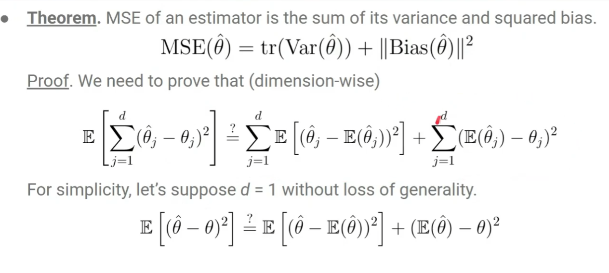

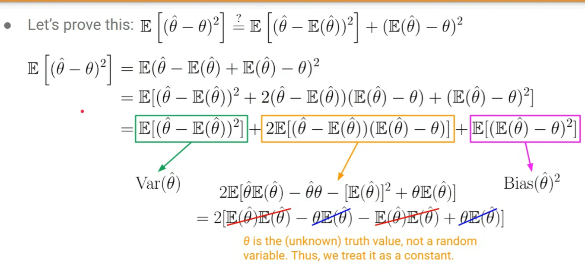
- $\hat\theta - \mathbb E(\hat\theta) + \mathbb E(\hat\theta) - \theta$로 쪼개서 제곱을 전개하면 가운데 항이 상쇄되어 사라진다. $\theta$는 확률변수가 아닌 상수로 취급한다.
- 남는 앞부분이 Variance, 뒷부분이 Bias²다.

bias / variance는 상충되는 관계다. MSE를 마음대로 줄일 수는 없어서, 하나를 줄이면 다른 하나가 커지는 경향이 있다. 둘을 모두 고려해야 한다.

linear regression에서는 bias가 0이다(앞에서 $\mathbb E[\hat\beta] = \beta$). variance는 데이터가 많아질수록 줄어든다.
- 그렇다고 MSE가 최소인 것은 아니다. 더 좋은 estimator도 있다. 다만 bias가 없는(unbiased) estimator 중에서는 가장 좋다고 알려져 있다. (증명은 생략)
- bias와 variance의 trade-off가 갖는 의미는 7강에서 overfitting 관점으로 다시 다룬다.
