# Efficient Memory Management for Large Language Model Serving with PagedAttention

> 참고: [arXiv:2309.06180](https://arxiv.org/abs/2309.06180) (SOSP '23)

## 1. 서론

GPT, PaLM 등 LLM의 등장으로 프로그래밍 어시스턴트, 범용 챗봇 같은 새로운 애플리케이션이 늘어나면서, LLM을 서빙하는 비용이 중요한 문제로 떠올랐다. LLM 요청 처리 비용은 기존 키워드 쿼리보다 10배 이상 비쌀 것으로 추정되며, 이런 높은 비용을 낮추려면 처리량(throughput)을 늘려야 한다.

**메모리 구성**: 13B 파라미터 모델을 NVIDIA A100 40GB에서 서빙할 때 메모리는 다음과 같이 나뉜다.

- 파라미터: 26GB(65%) — 서빙 중 GPU 메모리에 고정 유지
- KV 캐시: 30% 이상 — 요청마다 동적으로 할당/해제
- 기타(활성화 등): 나머지 소량

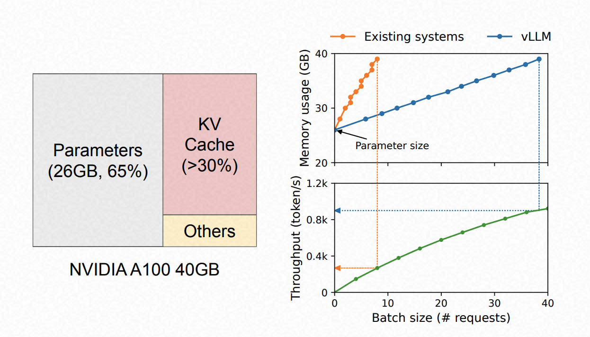

위 그림 오른쪽에서 보듯, 기존 시스템은 배치 크기가 커질수록 KV 캐시 메모리 사용량이 급격히 증가하는 반면, vLLM은 이 증가 곡선을 완만하게 만들어 처리량을 크게 끌어올린다.

LLM은 자기회귀형(autoregressive) 트랜스포머 모델이다 — 입력과 지금까지 생성한 토큰의 시퀀스를 기반으로 한 번에 하나의 단어를 생성한다. 이 순차적 생성 방식은 메모리 사용량에 크게 의존하기 때문에 GPU의 연산 능력을 충분히 활용하지 못한다(memory-bound).

요청을 배치로 묶어 처리하면 처리량을 향상시킬 수 있지만, 그러려면 요청마다 필요한 메모리 공간을 효율적으로 관리해야 한다.

기존 LLM 서빙 시스템은 KV 캐시 메모리를 효율적으로 관리하는 데 한계가 있다. 이는 대부분의 딥러닝 프레임워크가 텐서를 연속적인 메모리 공간에 저장하도록 요구하기 때문이다. 그러나 KV 캐시는 기존 딥러닝 워크로드와 달리 새로운 토큰을 생성함에 따라 동적으로 크기가 변하고, 그 수명과 길이를 사전에 알 수 없다는 특징이 있다. 이로 인해 기존 시스템은 다음 두 가지 문제를 겪는다.

- **내부·외부 메모리 단편화**: 요청의 최대 길이를 기준으로 미리 연속된 메모리를 할당하기 때문에 낭비가 발생한다
- **메모리 공유 기회를 활용하지 못함**: 병렬 샘플링, 빔 검색 같은 디코딩 알고리즘은 요청마다 여러 출력을 생성하는데, 이때 발생하는 메모리 공유 기회를 살릴 수 없다

이를 해결하기 위해, 운영체제의 가상 메모리·페이징 기법에서 영감을 받은 새로운 어텐션 알고리즘인 **PagedAttention**을 제안한다.

## 2. 배경

### 트랜스포머 기반 LLM과 셀프 어텐션

트랜스포머 기반 언어 모델의 핵심은 셀프 어텐션 레이어다. 입력 히든 상태 시퀀스에 대해, 셀프 어텐션은 각 위치마다 선형 변환을 적용해 쿼리(q), 키(k), 값(v) 벡터를 얻는다.

```
q_i = W_q · x_i,  k_i = W_k · x_i,  v_i = W_v · x_i
```

그리고 특정 위치의 쿼리 벡터와 이전의 모든 키 벡터를 곱해 어텐션 점수를 계산하고, 값 벡터에 대한 가중 평균으로 출력을 계산한다.

```
a_ij = exp(q_i^T k_j / √d) / Σ exp(q_i^T k_t / √d)
o_i  = Σ a_ij · v_j
```

### LLM 서비스 및 자연어 생성

LLM 서비스에서 생성 계산은 두 단계로 나뉜다.

- **프롬프트 단계 (prefill)**: 전체 프롬프트를 입력으로 받아 첫 번째 새로운 토큰의 확률을 계산. 모든 입력 토큰이 이미 주어져 있으므로 행렬-행렬 곱 연산으로 병렬화 가능 → GPU 병렬성을 효율적으로 활용
- **자기회귀 생성 단계 (decode)**: 나머지 토큰을 순차적으로 생성. 이전 반복에서 캐싱된 키/값 벡터를 재사용하고, 이번 반복의 새 토큰에 대한 키/값만 계산. 데이터 의존성 때문에 반복 간 병렬화가 불가능하고 행렬-벡터 곱셈을 사용 → GPU 연산을 충분히 활용하지 못하며 단일 요청 지연 시간의 대부분을 차지

동일한 토큰이라도 시퀀스 내 위치가 다르면 KV 캐시 값이 달라진다는 점도 중요하다.

### LLM을 위한 배치 처리 기법

요청들이 동일한 모델 가중치를 공유하므로, 배치로 묶어 처리하면 가중치 이동 오버헤드를 요청들 사이에 분산시킬 수 있다. 다만 배치 처리는 두 가지 이유로 단순하지 않다.

- 요청이 서로 다른 시간에 도착할 수 있음 — 단순한 배치 전략은 초기 요청이 후속 요청을 기다리게 하거나, 후속 요청을 지연시켜 대기 시간을 초래
- 요청마다 입력/출력 길이가 매우 다를 수 있음 — 길이를 맞추려고 패딩하면 GPU 연산과 메모리가 낭비됨

이를 해결하기 위해 셀룰러 배치, 반복 수준(iteration-level) 스케줄링 같은 세밀한 배치 메커니즘이 제안되었다. 이 방식들은 반복 단위로 동작해서, 매 반복이 끝날 때마다 완료된 요청을 배치에서 제거하고 새 요청을 추가한다. 이를 통해 큐잉 지연과 패딩 낭비를 줄여 처리량을 크게 향상시킨다.

## 3. Memory Challenges in LLM Serving

세밀한 배치 처리로도 GPU 메모리 용량, 특히 KV 캐시에 할당된 공간이 배치 가능한 요청 수를 제한한다. 즉 서빙 시스템의 처리량은 memory-bound다.

### 큰 KV 캐시

KV 캐시 크기는 요청 수에 따라 빠르게 증가한다. 예를 들어 13B 파라미터 OPT 모델의 경우, 토큰 하나의 KV 캐시는 다음과 같이 계산된다.

```
2 (key/value 벡터) × 5120 (hidden state 크기) × 40 (레이어 수) × 2 (FP16 byte 수) = 800KB
```

OPT는 최대 2048 토큰까지 생성 가능하므로, 요청 하나의 KV 캐시를 저장하는 데 최대 1.6GB가 필요할 수 있다. GPU 메모리 용량은 수십 GB 수준이라, 모든 메모리를 KV 캐시에 할당해도 겨우 수십 건의 요청만 처리할 수 있다. 게다가 GPU의 연산 속도가 메모리 용량보다 빠르게 증가하는 추세라(A100 → H100: FLOPS 2배 이상 증가, 메모리는 최대 80GB로 유지) 메모리는 점점 더 중요한 병목이 될 것으로 전망된다.

### 복잡한 디코딩 알고리즘

디코딩 알고리즘에 따라 메모리 공유 가능성이 달라진다.

- 단일 프롬프트에서 여러 임의 샘플을 요청하는 경우(프로그램 제안 등), 프롬프트 부분의 KV 캐시(전체 KV 캐시의 12%를 차지)는 공유해 메모리 사용량을 최소화할 수 있음
- 자기회귀 생성 단계의 KV 캐시는 서로 다른 샘플 결과·맥락·위치에 의존하므로 공유 불가
- 빔 검색처럼 더 정교한 알고리즘에서는 서로 다른 빔이 더 큰 비율(최대 55%)을 공유할 수 있고, 디코딩이 진행되면서 공유 패턴이 동적으로 변화

### 알 수 없는 입력·출력 길이

요청마다 입력/출력 길이가 다양하므로 메모리 관리 시스템은 다양한 프롬프트 길이를 처리할 수 있어야 한다. 출력 길이가 늘어날수록 KV 캐시가 필요로 하는 메모리도 증가해 가용 메모리를 소진시킬 수 있으므로, 시스템은 일부 요청의 KV 캐시를 삭제하거나 스왑아웃하는 등의 스케줄링 결정을 내려야 한다.

### 기존 시스템의 메모리 관리

기존 딥러닝 프레임워크는 대부분 텐서를 연속적인 메모리 공간에 저장하도록 요구하기 때문에, 기존 LLM 서빙 시스템도 요청의 KV 캐시를 연속적인 텐서로 저장한다. 출력 길이를 예측할 수 없으므로, 요청이 가질 수 있는 최대 시퀀스 길이를 기준으로 메모리 조각을 미리(static) 할당한다.

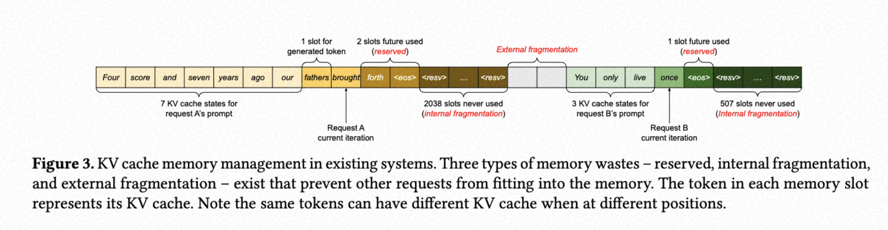

위 그림은 최대 길이 2048인 요청 A와 최대 512인 요청 B를 보여준다. 이런 사전 할당 방식은 세 가지 메모리 낭비를 초래한다.

- **예약된(reserved) 슬롯**: 아직 사용하지 않았지만 미래 토큰을 위해 남겨둔 공간
- **내부 단편화(internal fragmentation)**: 실제 시퀀스 길이가 최대 길이보다 훨씬 짧아서 발생하는 낭비 — 요청이 끝나야만 낭비였음이 드러남
- **외부 단편화(external fragmentation)**: 버디 얼로케이터 같은 메모리 할당자 자체에서 발생하며, 요청을 처리하기 전부터 이미 사용 불가능한 상태

세 낭비 모두 순수한 손실이다. 예약된 메모리는 결국 쓰이긴 하지만, 요청의 전체 수명 동안 그 공간을 독점하기 때문에 다른 짧은 요청이 그 일부조차 사용할 수 없다. 실제 프로파일링 결과, 기존 시스템에서는 KV 캐시 메모리의 **20.4%~38.2%만 실제 토큰 상태를 저장하는 데 사용**되었다.

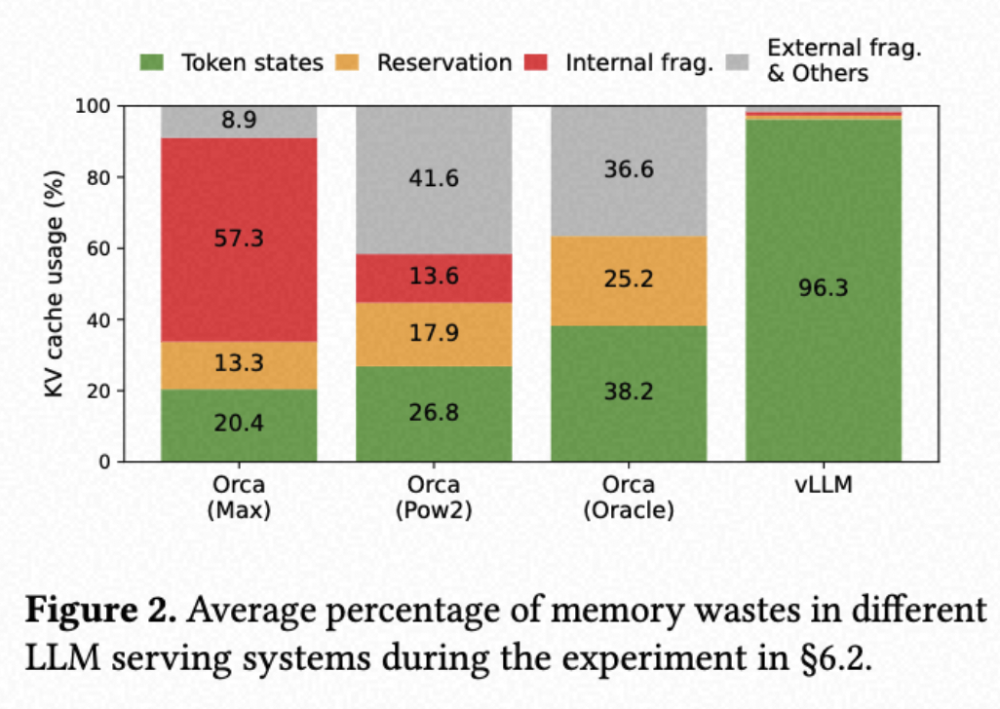

압축(compaction)이 단편화의 잠재적 해결책으로 제안된 적 있지만, 거대한 KV 캐시를 다루는 성능 민감한 LLM 서빙 시스템에서 압축을 수행하는 것은 비현실적이다. 압축을 쓰더라도 사전 할당된 청크 공간은 디코딩 알고리즘에 특화된 메모리 공유를 여전히 막는다.

## 4. Method

이 문제를 해결하기 위해 새로운 어텐션 알고리즘 **PagedAttention**과, 이를 기반으로 한 서빙 엔진 **vLLM**을 제안한다.

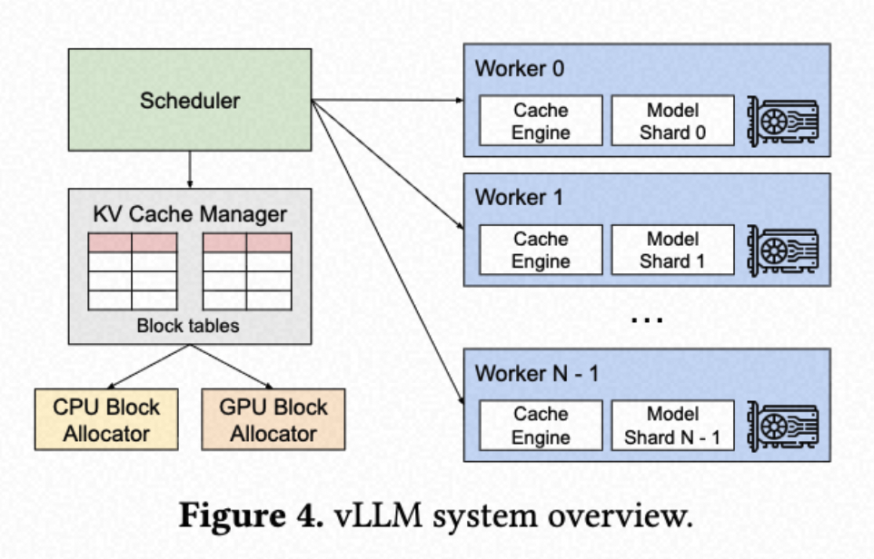

vLLM은 중앙 집중식 스케줄러가 분산된 GPU 워커들의 실행을 조율하는 구조다. KV 캐시 관리자가 PagedAttention을 통해 KV 캐시를 페이지 방식으로 효율적으로 관리하며, 스케줄러가 내린 명령에 따라 각 GPU 워커의 물리적 KV 캐시 메모리를 관리한다.

### PagedAttention

운영체제의 고전적인 페이징 개념에서 영감을 받은 어텐션 알고리즘으로, 연속적인 키·값을 비연속적인 메모리 공간에 저장할 수 있게 한다. 각 시퀀스의 KV 캐시를 고정된 토큰 수(block size)만큼의 **KV 블록**으로 분할한다.

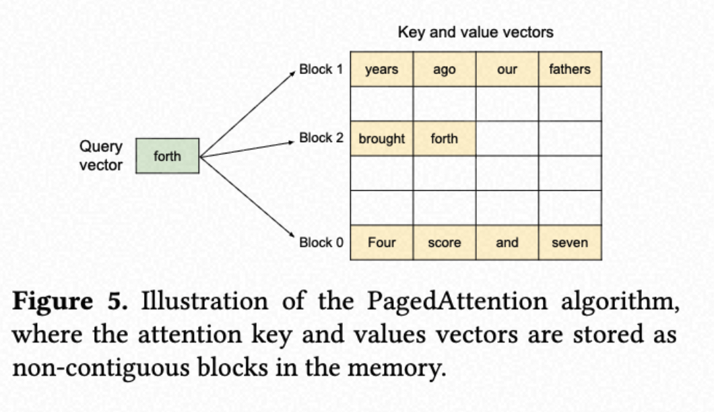

##### 1. Block (블록)

- KV 캐시를 고정 크기 블록으로 나눔
- 각 블록은 K개의 토큰의 KV 캐시를 담는 단위 (예: block_size = 4면 블록 하나에 토큰 4개분 KV 저장)

##### 2. Block Table (블록 테이블)

- 각 요청마다 "몇 번 블록에 내 KV가 있는지" 매핑 테이블 유지
- OS의 페이지 테이블과 동일한 역할

##### 3. Block Manager

- 전체 물리 블록 풀을 관리
- 빈 블록의 할당·반환을 담당

**Attention 계산**

기존 어텐션은 K가 연속 메모리에 있어야 행렬 곱이 가능하지만, PagedAttention은 블록 테이블을 보고 필요한 블록들을 개별적으로 가져와 블록 단위로 어텐션을 계산한다.

```
기존 Attention:
Q · K^T  ← K가 연속 메모리에 있어야 행렬 곱 가능

PagedAttention:
Q · [K_블록3, K_블록7, K_블록1]^T
    ↑ 블록 테이블 보고 블록별로 가져와서 계산
    ↑ 블록 단위로 쪼개서 Attention 수행
```

수식으로는, 블록 크기 B에 대해 j번째 키/값 블록을 `K_j`, `V_j`라 하면 어텐션 계산은 다음과 같은 블록 단위 연산으로 변환된다.

```
A_ij = softmax(q_i^T · K_j / √d)   (j번째 KV 블록에 대한 어텐션 점수)
o_i  = Σ_j V_j · A_ij
```

**KV 캐시 공유**

```
프롬프트 "오늘 날씨는" 처리
→ 블록 1, 2, 3에 KV 저장

샘플 1 생성 시작 ─┐
샘플 2 생성 시작 ─┤ → 블록 1,2,3을 reference count만 올려서 공유
샘플 3 생성 시작 ─┘    (복사 안 함!)

샘플 1이 새 토큰 생성
→ 그때서야 블록 복사 (Copy-on-Write)
→ 각자 독립적인 블록에서 이어서 생성
```

### KV Cache Manager

vLLM의 메모리 관리 방식은 OS의 가상 메모리와 유사하다. OS는 메모리를 고정 크기 페이지로 나누고, 사용자 프로그램의 논리적 페이지를 물리적 페이지에 매핑한다. 논리적 페이지가 연속적이지 않아도 프로그램은 마치 연속된 메모리처럼 접근할 수 있고, 물리적 메모리도 미리 전부 예약할 필요 없이 필요할 때 동적으로 할당된다.

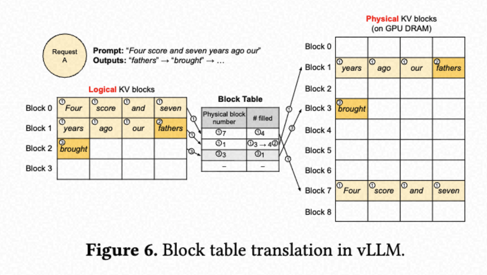

KV 캐시는 논리적인 KV 블록들의 연속으로 표현되며, 새로운 토큰과 그에 따른 KV 캐시가 생성될 때마다 왼쪽에서 오른쪽으로 채워진다. GPU 워커에서는 블록 엔진(block engine)이 GPU DRAM의 연속적인 영역을 할당하고, 이를 물리적 KV 블록들로 나눈다(CPU RAM에서도 스와핑을 위해 동일한 방식 사용). KV 블록 관리자는 각 요청에 대한 논리적·물리적 KV 블록 간의 매핑을 담은 블록 테이블을 관리한다. 각 블록 테이블 항목은 해당 논리 블록에 대응하는 물리 블록과, 그 블록에 채워진 위치 수를 기록한다.

### PagedAttention 및 vLLM을 이용한 디코딩

단일 입력 시퀀스의 디코딩 과정을 예로 들면:

1. **프롬프트 계산**: vLLM은 OS의 가상 메모리처럼 생성 가능한 최대 시퀀스 길이만큼 메모리를 미리 예약하지 않는다. 프롬프트 계산 중 생성되는 KV 블록만큼만 필요한 만큼 할당한다.
2. **프롬프트 채우기**: 일반적인 셀프 어텐션 알고리즘으로 프롬프트와 첫 출력 토큰의 KV 캐시를 생성 → 첫 토큰의 KV 캐시와 다음 3개 토큰을 논리 블록 0, 1에 저장. 나머지 공간은 디코드 단계에 할당
3. **디코딩 단계**: 새로운 토큰이 생성되면 마지막 논리 블록의 남은 슬롯에 저장하고, 블록이 다 차면 새로운 논리 블록을 할당하고 그에 맞는 물리 블록을 새로 매핑

전체적으로, 각 디코딩 반복마다 vLLM은 먼저 배치용 후보 시퀀스를 선택하고, 새로운 논리 블록에 필요한 물리적 블록을 할당한 다음, 현재 반복의 모든 입력 토큰을 연결한다.

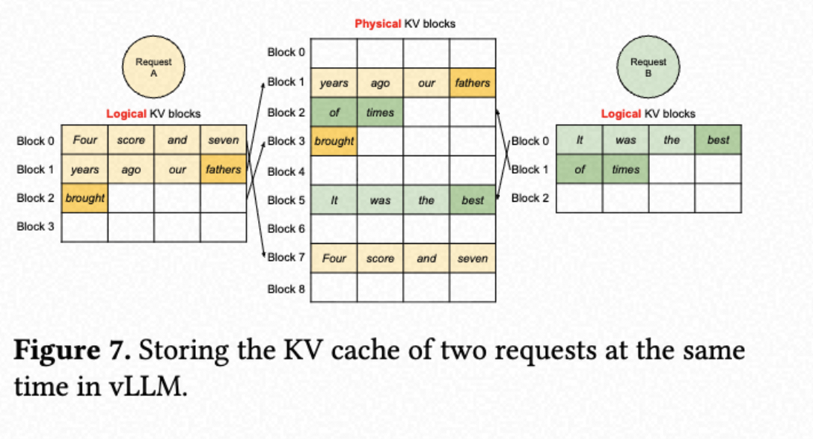

하나의 KV 블록 내에 여러 토큰을 저장하는 것은 PagedAttention 커널이 더 많은 위치에서 KV 캐시를 병렬로 처리할 수 있게 하여 하드웨어 활용도를 높이고 지연 시간을 줄인다(단, 블록이 너무 크면 메모리 단편화가 늘어남).

모든 블록이 왼쪽에서 오른쪽으로 채워지고, 새로운 물리 블록은 이전 모든 블록이 다 찬 후에만 할당되므로, vLLM은 한 블록 내에서만 메모리 낭비가 발생하도록 제한해 메모리를 효율적으로 활용한다. 이를 통해 더 많은 요청을 배치에 담을 수 있어 처리량이 향상된다. 요청이 완료되면 해당 KV 블록은 다른 요청을 위해 해제된다.

### 다른 디코딩 시나리오에 대한 적용

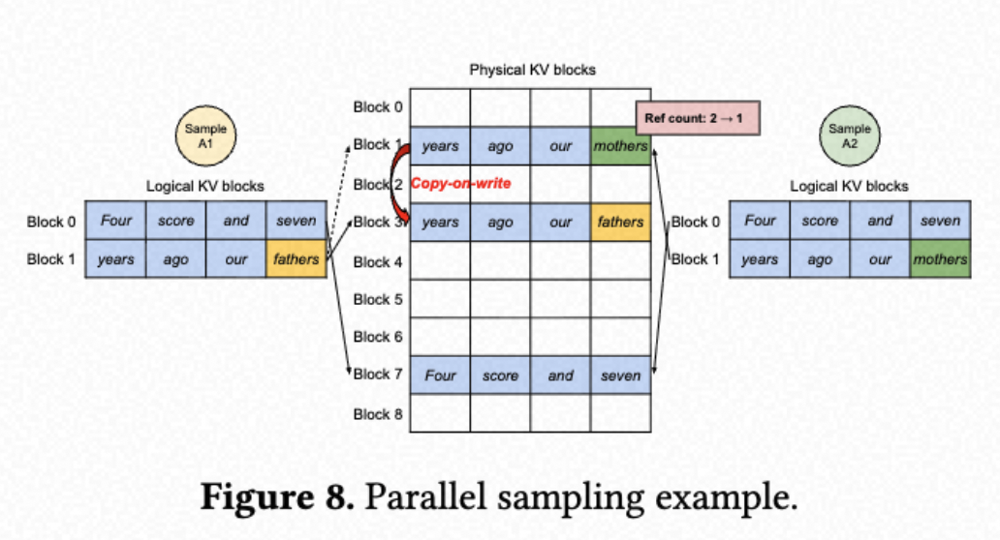

**병렬 샘플링**

하나의 입력 프롬프트에 대해 LLM이 여러 개의 샘플링된 출력을 생성하는 경우(프로그램 어시스턴트 등)로, 요청이 여러 시퀀스를 생성한다.

프롬프트 단계에서는 한 개의 복사본만 할당한다.

```
프롬프트 토큰들의 KV 캐시:

물리 블록 7: [Four, score, and, seven]   ← A1, A2 둘 다 가리킴
물리 블록 1: [years, ago, our, fathers]  ← A1, A2 둘 다 가리킴

A1 블록 테이블:          A2 블록 테이블:
논리블록0 → 물리블록7    논리블록0 → 물리블록7
논리블록1 → 물리블록1    논리블록1 → 물리블록1
                                  ↑
                         둘이 같은 물리 블록 공유
                         참조 횟수(ref count) = 2
```

생성 단계에서 갈라진다. A1은 "mothers"를, A2는 "fathers" 이후 다른 토큰을 생성한다고 하면, A1이 마지막 블록(물리 블록 1)에 쓰려는 순간:

```
물리 블록 1의 ref count = 2  ← "나 말고 다른 애도 쓰고 있네"
                              ← 그냥 쓰면 A2 데이터 망가짐!
```

**→ Copy-on-Write 발동!**

```
1. 새 물리 블록 3 할당
2. 물리 블록 1 내용을 블록 3으로 복사
3. A1의 블록 테이블 업데이트: 논리블록1 → 물리블록3 (새 블록으로)
4. 물리 블록 1의 ref count: 2 → 1
5. A1은 블록 3에 "mothers" KV 씀
```

A2가 물리 블록 1에 쓸 때는 ref count가 1이 되어 있으므로 그냥 직접 쓴다(복사 불필요).

**최종 상태**

```
물리 블록 7: [Four, score, and, seven]  ← A1, A2 여전히 공유 (변경 없음)
물리 블록 3: [years, ago, our, mothers] ← A1 전용 (복사 후 수정)
물리 블록 1: [years, ago, our, fathers] ← A2 전용 (직접 수정)

A1 블록 테이블:          A2 블록 테이블:
논리블록0 → 물리블록7    논리블록0 → 물리블록7  ← 공유 유지
논리블록1 → 물리블록3    논리블록1 → 물리블록1  ← 각자 독립
```

```
기존 방식:
A1용 프롬프트 KV 복사본 1개
A2용 프롬프트 KV 복사본 1개
→ 프롬프트가 길수록 메모리 2배

PagedAttention CoW:
프롬프트 KV는 1개만 유지
→ 실제로 달라지는 순간에만 복사
→ 프롬프트가 길수록 절약 효과 극대화
```

**빔 검색**

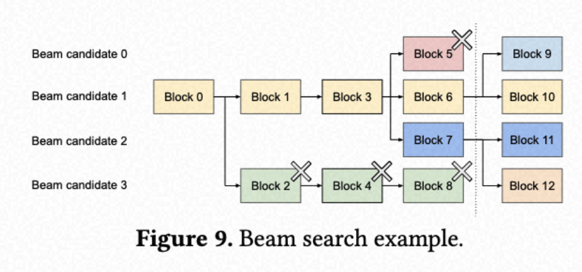

가장 가능성 있는 출력 시퀀스를 디코딩하는 알고리즘이다. vLLM은 초기 프롬프트 블록뿐 아니라 다양한 후보 간의 다른 블록도 공유하며, 디코딩 과정에서 공유 패턴이 동적으로 변한다.

**공통 프롬프트 (시스템 프롬프트)**

많은 프롬프트가 공통된 prefix를 공유하므로 캐싱하기 쉽다. 시스템 프롬프트의 KV 캐시를 미리 계산해서 물리 블록에 고정 저장해둘 수 있다.

### 스케줄링 및 우선순위

시스템 용량을 초과하는 요청 트래픽이 발생하면 모든 요청에 대해 FCFS(First Come First Serve) 정책을 사용한다. 가비지 컬렉션은 사용되지 않는 블록을 CPU 메모리로 복사하는 방식으로 이뤄진다.

### 분산 실행

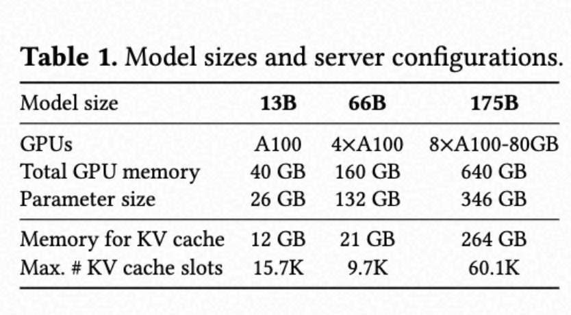

많은 LLM은 파라미터 크기가 단일 GPU 용량보다 크므로 병렬 모델 실행 방식이 필요하다. 어텐션 연산은 어텐션 헤드 차원을 기준으로 분할된다. 모델 병렬 실행 방식에서도 각 모델 조각이 동일한 입력 토큰 세트를 처리하므로, 동일한 위치에 대한 KV 캐시가 필요하다.

#### 왜 "같은 위치의 KV 캐시"가 필요한가

KV 캐시는 위치마다 다르다(같은 단어도 위치가 다르면 KV 값이 다름 — 포지셔널 인코딩 때문).

```
"score"가 2번째 위치일 때의 KV  ≠  "score"가 5번째 위치일 때의 KV
```

모든 GPU가 같은 토큰 시퀀스를 처리하므로:

```
GPU 0의 KV 캐시: position 0~3의 헤드0,1 부분
GPU 1의 KV 캐시: position 0~3의 헤드2,3 부분
GPU 2의 KV 캐시: position 0~3의 헤드4,5 부분
GPU 3의 KV 캐시: position 0~3의 헤드6,7 부분

모두 동일한 position(0,1,2,3)에 대한 KV → "같은 위치의 KV 캐시 필요"
```

#### vLLM의 처리 방식

```
중앙 KV 캐시 관리자 (스케줄러)
         ↓
논리블록 → 물리블록 매핑 테이블 (하나만 유지)
         ↓
GPU 0, 1, 2, 3이 모두 이 테이블 공유

"논리블록 2 → 물리블록 5" 라는 매핑은 모든 GPU가 동일하게 사용
단, 각 GPU는 그 블록 안에서 자기 담당 헤드의 KV만 저장
```

GPU마다 담당 헤드는 달라도 처리하는 토큰 시퀀스(위치)는 동일하다. 그러므로 블록 테이블은 하나만 만들어 공유하고, 각 GPU는 그 블록에서 자기 헤드 부분만 채우면 된다.

## 5. 구현

vLLM은 FastAPI 프론트엔드와 GPU 기반 추론 엔진으로 구성된다. OpenAI API 인터페이스를 확장해 사용자가 요청마다 샘플링 파라미터를 자유롭게 설정할 수 있게 한다.

### 커널 수준 최적화

여러 개의 커스텀 GPU 커널을 개발했다.

**① 결합형 재구성 및 블록 쓰기**

- 새 KV 캐시 생성 시 계산 → 재구성 → 저장의 3단계가 원래 커널 3번 실행
- 이 3가지를 단일 커널로 통합 → 커널 런칭 오버헤드 감소

**② 블록 읽기와 Attention 결합**

- 기존 Attention 커널은 연속 메모리 가정 → 블록 테이블 기반 비연속 접근 불가
- FasterTransformer 커널을 블록 테이블 기반으로 수정
- 블록 1개당 GPU 워프 1개 할당 → 메모리 접근 패턴 최적화
- 배치 내 요청들의 시퀀스 길이가 달라도 단일 커널로 처리 가능

**③ 블록 복사 (CoW 복사)**

- CoW 발동 시 블록마다 `cudaMemcpyAsync` 개별 호출 → API 오버헤드 누적
- 여러 블록 복사 작업을 하나의 커널 런으로 통합 → 호출 횟수 최소화

### 다양한 디코딩 알고리즘 지원

- 포크(fork): 기존 시퀀스에서 새로운 시퀀스 생성
- 추가(append): 시퀀스에 새로운 토큰 추가
- 삭제(free): 시퀀스 삭제

## 6. 평가

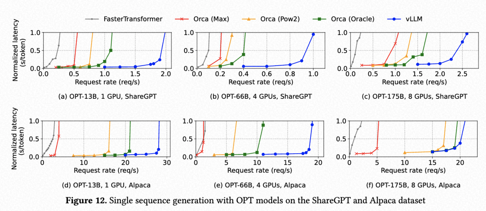

OPT-13B(1 GPU), OPT-66B(4 GPU), OPT-175B(8 GPU)를 ShareGPT·Alpaca 데이터셋으로 평가한 결과, vLLM은 FasterTransformer·Orca 계열(Max/Pow2/Oracle) 대비 동일한 정규화 지연(normalized latency) 수준에서 훨씬 높은 요청률(request rate)을 처리한다. 모델이 크고 시퀀스가 길수록, 그리고 디코딩 알고리즘이 복잡할수록(병렬 샘플링, 빔 검색 등) vLLM의 처리량 우위가 더 두드러진다. 논문 전체 평가에서 vLLM은 FasterTransformer·Orca 대비 **2~4배** 처리량 향상을 보이며, 모델 정확도에는 영향을 주지 않는다.
